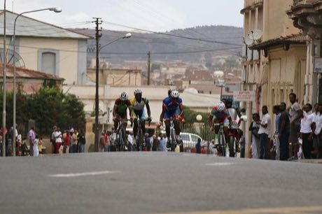

# Asmara highland road race

*Tour of Eritrea*

**Encyclopedia ID 193** (permanent) · https://equalinformation.com/world-heritage-games-site/games/193-asmara-highland-road-race/

*Photo: Carlos Oliveira Reis, [CC0](https://creativecommons.org/publicdomain/zero/1.0/), [source on Wikimedia Commons](https://commons.wikimedia.org/wiki/File:Tour_of_Asmara_Cycling_race,_Asmara_Eritrea.jpg)*

Pace a team of cyclists up long highland switchbacks, choosing when to attack, draft or save energy to win the stage.

## Heritage note

Part of the living heritage of Eritrea.

## Origins

Usually placed in the era of Age of Contact and Craft (about 1500 to 1800), although its exact origins are uncertain, within the cultural world of Africa: Nile and the Horn.

## Facts

- **Where:** Eritrea
- **Type:** Racing
- **Era:** [Age of Contact and Craft](../../eras/contact/index.md) (uncertain)
- **Cradle:** [Africa: Nile and the Horn](../../cradles/africa-nile/index.md)
- **Region:** Sub-Saharan Africa

## Related entries

- [Nile Felucca Sailing](../../games/216-nile-felucca-sailing/index.md)
- [Seega](../../games/692-seega/index.md)
- [Krar lyre](../../games/126-krar-lyre/index.md)
- [Jebena coffee brewing](../../games/189-jebena-coffee-brewing/index.md)
- [Abalala'e](../../games/699-abalalae/index.md)
- [Andada](../../games/700-andada/index.md)

## Sources

- <https://commons.wikimedia.org/wiki/File:Tour_of_Asmara_Cycling_race,_Asmara_Eritrea.jpg>
