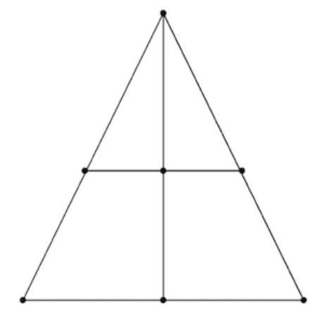

# Tsoro Yematatu

*Also known as: three-in-a-row triangle*

**Encyclopedia ID 196** (permanent) · https://bpupadhyaya.github.io/world-heritage-games-site/games/196-tsoro-yematatu/

*Photo: Duane Habecker, [Public domain](https://creativecommons.org/publicdomain/mark/1.0/), [source on Wikimedia Commons](https://commons.wikimedia.org/wiki/File:Tsoro.png)*

Each side drops three stones on the seven points of a triangle-with-a-bar, then slides them along lines one step at a time to make three in a row.

## Heritage note

Part of the living heritage of Zimbabwe. Some forms of this practice carry deep meaning for the communities who keep it; here we describe the play and the craft only, with respect for its roots.

## Origins

Usually placed in the era of River Valleys and First Cities (about 3000 to 1000 BCE), although its exact origins are uncertain, within the cultural world of Africa: Southern Africa.

## Facts

- **Where:** Zimbabwe
- **Type:** Board and table games
- **Family:** Mill and morris games
- **Era:** [River Valleys and First Cities](../../eras/river-valleys/index.md) (uncertain)
- **Cradle:** [Africa: Southern Africa](../../cradles/africa-south/index.md)
- **Region:** Sub-Saharan Africa

## Play it

[Try a 90-second preview in your browser](https://bpupadhyaya.github.io/games-site/games/tsoro-yematatu/play/) · [Google Play](https://play.google.com/store/apps/details?id=com.equalinformation.arcforge.shell) · [App Store](https://apps.apple.com/us/app/arcforge-world-heritage-games/id6813746442)

## Related entries

- [Umlabalaba](../../games/881-umlabalaba/index.md)
- [Potta](../../games/579-potta/index.md)
- [Nine Men's Morris](../../games/740-nine-mens-morris/index.md)
- [Thin Hama](../../games/918-thin-hama/index.md)
- [Tapatan](../../games/1026-tapatan/index.md)
- [Mill](../../games/1061-mill/index.md)

## Sources

- <https://commons.wikimedia.org/wiki/File:Tsoro.png>
