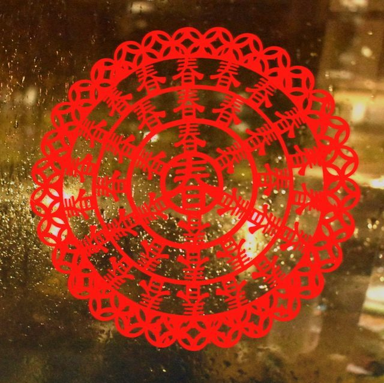

# Chinese paper cutting

**Encyclopedia ID 1987** (permanent) · https://bpupadhyaya.github.io/world-heritage-games-site/games/1987-chinese-paper-cutting/

*Photo: Lanneixi, [CC BY-SA 4.0](https://creativecommons.org/licenses/by-sa/4.0/), [source on Wikimedia Commons](https://commons.wikimedia.org/wiki/File:Chinese_Paper_Cutting.png)*

Fold coloured paper in half, quarters or twelfths, snip the wedge with scissors or punches, then unfold it in real 3D to reveal the pattern.

## How it is played

Pick a fold: the paper folds itself into one small wedge. A cut on a fold edge opens into one whole shape; a cut at the centre becomes the middle.

## Heritage note

Part of the living heritage of China.

## Origins

A living tradition passed from person to person; it is not tied to a single dated origin. It belongs to the cultural world of China.

## Facts

- **Where:** China
- **Type:** Crafts and making
- **Family:** Paper, ink and painting crafts
- **Era:** [Living Traditions](../../eras/living/index.md)
- **Cradle:** [China](../../cradles/china/index.md)
- **Region:** East and Southeast Asia

## Play it

[Try a 90-second preview in your browser](https://bpupadhyaya.github.io/games-site/games/paper-cutting-fold-snip/play/) · [Google Play](https://play.google.com/store/apps/details?id=com.equalinformation.arcforge.shell) · [App Store](https://apps.apple.com/us/app/arcforge-world-heritage-games/id6813746442)

## Related entries

- [Chinese knotting](../../games/26-chinese-knotting/index.md)
- [Cloisonne](../../games/343-cloisonne/index.md)
- [Oil-paper umbrella making](../../games/344-oil-paper-umbrella-making/index.md)
- [Peranakan beaded slippers](../../games/1358-peranakan-beaded-slippers/index.md)
- [Cheongsam Tailor Shop](../../games/1462-cheongsam-tailor-shop/index.md)
- [Ebru paper marbling](../../games/20-ebru-paper-marbling/index.md)

## Sources

- <https://en.wikipedia.org/wiki/Chinese_paper_cutting>
