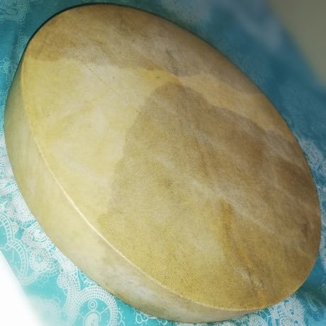

# Sega ravanne drum

*Also known as: Sega tipik · ravanne*

**Encyclopedia ID 199** (permanent) · https://bpupadhyaya.github.io/world-heritage-games-site/games/199-sega-ravanne-drum/

*Photo: MU Music Contributor, [CC BY-SA 4.0](https://creativecommons.org/licenses/by-sa/4.0/), [source on Wikimedia Commons](https://commons.wikimedia.org/wiki/File:Ravanne.jpg)*

Sega ravanne drum is a musical instrument tradition from Mauritius.

## Heritage note

Part of the living heritage of Mauritius.

## Origins

Usually placed in the era of Modern Heritage (1800 to today), although its exact origins are uncertain, within the cultural world of Africa: Great Lakes and Indian Ocean.

## Facts

- **Where:** Mauritius
- **Type:** Musical instruments
- **Family:** Drums and percussion
- **Era:** [Modern Heritage](../../eras/modern/index.md) (uncertain)
- **Cradle:** [Africa: Great Lakes and Indian Ocean](../../cradles/africa-east/index.md)
- **Region:** Sub-Saharan Africa

## Play it

[Try a 90-second preview in your browser](https://bpupadhyaya.github.io/games-site/games/sega-ravanne-drum/play/) · [Google Play](https://play.google.com/store/apps/details?id=com.equalinformation.arcforge.shell) · [App Store](https://apps.apple.com/us/app/arcforge-world-heritage-games/id6813746442)

## Related entries

- [Chinchinero Drum Walk](../../games/1406-chinchinero-drum-walk/index.md)
- [Djembe](../../games/2189-djembe/index.md)
- [Kundu drum](../../games/6417-kundu-drum/index.md)
- [Amadinda and embaire](../../games/185-amadinda-and-embaire/index.md)
- [Burundian drum ensemble](../../games/1250-burundian-drum-ensemble/index.md)
- [Namalwa friction drum](../../games/7919-namalwa-friction-drum/index.md)

## Sources

- <https://commons.wikimedia.org/wiki/File:Ravanne.jpg>
