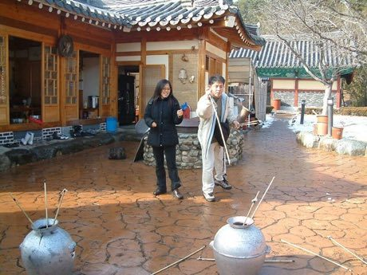

# Pitch-pot

*投壺 / 투호 · touhu / tuho*

**Encyclopedia ID 2** (permanent) · https://equalinformation.com/world-heritage-games-site/games/2-pitch-pot/

*Photo: Kang Byeong Kee, [CC BY 3.0](https://creativecommons.org/licenses/by/3.0/), [source on Wikimedia Commons](https://commons.wikimedia.org/wiki/File:Korea_Traditional_Game_Tuho.jpg)*

Pitch slender arrows from a set distance into a narrow-necked bronze jar, scoring for in-the-mouth, ear-hole and bounce-ins, with tricky ear shots.

## Heritage note

Part of the living heritage of China, South Korea. Some forms of this practice carry deep meaning for the communities who keep it; here we describe the play and the craft only, with respect for its roots.

## Origins

Usually placed in the era of Modern Heritage (1800 to today), although its exact origins are uncertain, within the cultural world of China.

## Facts

- **Where:** China, South Korea
- **Type:** Dexterity and skill games
- **Family:** Archery and target games
- **Era:** [Modern Heritage](../../eras/modern/index.md) (uncertain)
- **Cradle:** [China](../../cradles/china/index.md)
- **Region:** East and Southeast Asia

## Related entries

- [Jukskei](../../games/11-jukskei/index.md)
- [Lagori](../../games/14-lagori/index.md)
- [Tejo](../../games/57-tejo/index.md)
- [Chilean Rayuela](../../games/1427-chilean-rayuela/index.md)
- [Bocce](../../games/830-bocce/index.md)
- [Petanque](../../games/872-petanque/index.md)

## Sources

- <https://commons.wikimedia.org/wiki/File:Korea_Traditional_Game_Tuho.jpg>
