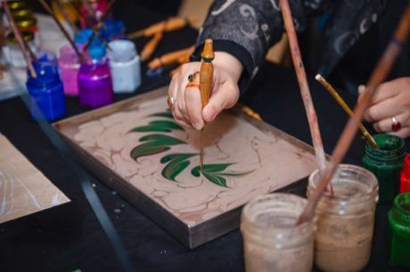

# Ebru paper marbling

*Ebru (Turkish) / Abru*

**Encyclopedia ID 20** (permanent) · https://bpupadhyaya.github.io/world-heritage-games-site/games/20-ebru-paper-marbling/

*Photo: Metasqaure10, [CC0](https://creativecommons.org/publicdomain/zero/1.0/), [source on Wikimedia Commons](https://commons.wikimedia.org/wiki/File:Ebru_(Water_Marbling)_Art.jpg)*

Drop pigment on a thickened water tray, then draw with a stylus, comb and fine brush to pull swirls, flowers and tulips; lay paper on top to print the result.

## Heritage note

Part of the living heritage of Turkey.

## Origins

A living tradition passed from person to person; it is not tied to a single dated origin. It belongs to the cultural world of Mesopotamia, Levant and Arabia.

## Facts

- **Where:** Turkey
- **Type:** Crafts and making
- **Family:** Paper, ink and painting crafts
- **Era:** [Living Traditions](../../eras/living/index.md)
- **Cradle:** [Mesopotamia, Levant and Arabia](../../cradles/mesopotamia-levant/index.md)
- **Region:** Middle East and North Africa

## Related entries

- [Jordanian Sand Bottle Art](../../games/219-jordanian-sand-bottle-art/index.md)
- [Al-Qatt Al-Asiri Wall Painting](../../games/1231-al-qatt-al-asiri-wall-painting/index.md)
- [Keffiyeh Pattern Loom](../../games/1310-keffiyeh-pattern-loom/index.md)
- [Qamariya Gypsum Window Designer](../../games/1368-qamariya-gypsum-window-designer/index.md)
- [Ndebele geometric wall painting](../../games/23-ndebele-geometric-wall-painting/index.md)
- [Chinese knotting](../../games/26-chinese-knotting/index.md)

## Sources

- <https://commons.wikimedia.org/wiki/File:Ebru_(Water_Marbling)_Art.jpg>
