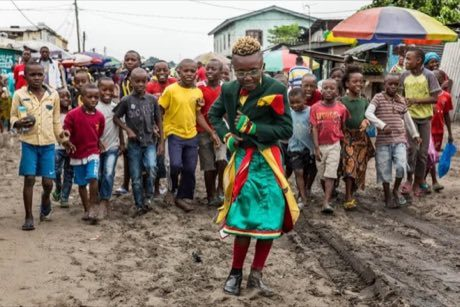

# La Sape dress-up parade

*La Sape · the Society of Ambiance-Makers and Elegant People*

**Encyclopedia ID 200** (permanent) · https://bpupadhyaya.github.io/world-heritage-games-site/games/200-la-sape-dress-up-parade/

*Photo: Kani Beat, [CC0](https://creativecommons.org/publicdomain/zero/1.0/), [source on Wikimedia Commons](https://commons.wikimedia.org/wiki/File:Jeune_Sapeue.webp)*

Mix bold coloured suits, hats, ties, shoes and canes to match a colour theme, then strut a street-parade rhythm and be judged by neighbours for harmony and daring.

## Heritage note

Part of the living heritage of Congo.

## Origins

Usually placed in the era of Modern Heritage (1800 to today), although its exact origins are uncertain, within the cultural world of Africa: Sahel, West and Central.

## Facts

- **Where:** Congo
- **Type:** Street and playground games
- **Era:** [Modern Heritage](../../eras/modern/index.md) (uncertain)
- **Cradle:** [Africa: Sahel, West and Central](../../cradles/africa-west/index.md)
- **Region:** Sub-Saharan Africa

## Related entries

- [Kuli](../../games/1041-kuli/index.md)
- [Bozo Net Casting](../../games/169-bozo-net-casting/index.md)
- [Akan Gold-Weight Balance](../../games/171-akan-gold-weight-balance/index.md)
- [Dambe](../../games/987-dambe/index.md)
- [African draughts](../../games/586-african-draughts/index.md)
- [Putu](../../games/609-putu/index.md)

## Sources

- <https://commons.wikimedia.org/wiki/File:Jeune_Sapeue.webp>
