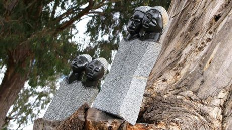

# Shona stone sculpture carving

*Shona sculpture*

**Encyclopedia ID 203** (permanent) · https://bpupadhyaya.github.io/world-heritage-games-site/games/203-shona-stone-sculpture-carving/

*Photo: COSV, [CC BY-SA 3.0](https://creativecommons.org/licenses/by-sa/3.0/), [source on Wikimedia Commons](https://commons.wikimedia.org/wiki/File:COSV_-_Zimbabwe_2008_-_Arte_Shona_(4).jpg)*

Chip, rasp and polish a block of serpentine or springstone along guide lines to reveal a family, bird or abstract figure, finishing with wax for the glossy sheen.

## Heritage note

Part of the living heritage of Zimbabwe.

## Origins

A living tradition passed from person to person; it is not tied to a single dated origin. It belongs to the cultural world of Africa: Southern Africa.

## Facts

- **Where:** Zimbabwe
- **Type:** Crafts and making
- **Family:** Pottery, wood and metal crafts
- **Era:** [Living Traditions](../../eras/living/index.md)
- **Cradle:** [Africa: Southern Africa](../../cradles/africa-south/index.md)
- **Region:** Sub-Saharan Africa

## Related entries

- [Swazi carved figures and craft market](../../games/1377-swazi-carved-figures-and-craft-market/index.md)
- [Zellij tile mosaic](../../games/21-zellij-tile-mosaic/index.md)
- [Swahili carved door](../../games/90-swahili-carved-door/index.md)
- [Thai fruit and vegetable carving](../../games/114-thai-fruit-and-vegetable-carving/index.md)
- [Glassblowing](../../games/121-glassblowing/index.md)
- [Azulejo tile painting](../../games/122-azulejo-tile-painting/index.md)

## Sources

- <https://commons.wikimedia.org/wiki/File:COSV_-_Zimbabwe_2008_-_Arte_Shona_(4).jpg>
