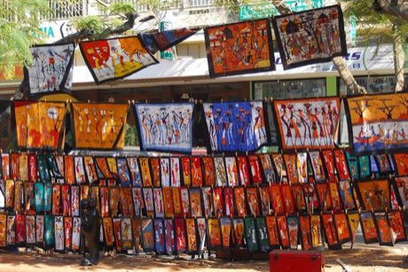

# Capulana wrap cloth printing and tying

*Capulana*

**Encyclopedia ID 204** (permanent) · https://equalinformation.com/world-heritage-games-site/games/204-capulana-wrap-cloth-printing-and-tying/

*Photo: F Mira from Lisbon, Portugal, [CC BY-SA 2.0](https://creativecommons.org/licenses/by-sa/2.0/), [source on Wikimedia Commons](https://commons.wikimedia.org/wiki/File:Capulanas_(3911443049).jpg)*

Pick printed cloth, learn the traditional wraps, skirts, head ties and baby carries, and match fabrics to occasions in a market-stall styling game.

## Heritage note

Part of the living heritage of Mozambique.

## Origins

A living tradition passed from person to person; it is not tied to a single dated origin. It belongs to the cultural world of Africa: Southern Africa.

## Facts

- **Where:** Mozambique
- **Type:** Crafts and making
- **Family:** Paper, ink and painting crafts
- **Era:** [Living Traditions](../../eras/living/index.md)
- **Cradle:** [Africa: Southern Africa](../../cradles/africa-south/index.md)
- **Region:** Sub-Saharan Africa

## Related entries

- [Ndebele geometric wall painting](../../games/23-ndebele-geometric-wall-painting/index.md)
- [Zulu beadwork letters](../../games/88-zulu-beadwork-letters/index.md)
- [Basotho blanket pattern designer](../../games/201-basotho-blanket-pattern-designer/index.md)
- [Ebru paper marbling](../../games/20-ebru-paper-marbling/index.md)
- [Chinese knotting](../../games/26-chinese-knotting/index.md)
- [Matryoshka](../../games/28-matryoshka/index.md)

## Sources

- <https://commons.wikimedia.org/wiki/File:Capulanas_(3911443049).jpg>
