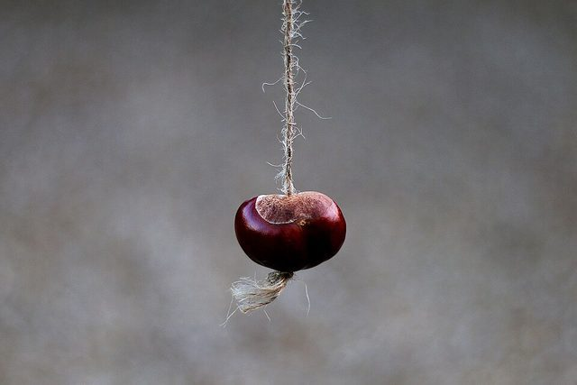

# Conkers

**Encyclopedia ID 2047** (permanent) · https://bpupadhyaya.github.io/world-heritage-games-site/games/2047-conkers/

*Photo: Kevin Doncaster, [CC BY 3.0](https://creativecommons.org/licenses/by/3.0/), [source on Wikimedia Commons](https://commons.wikimedia.org/wiki/File:Conker_(248814699).jpeg)*

Conkers is the autumn playground game of Britain and Ireland, played with the glossy brown seeds of the horse chestnut tree threaded on a length of string. Two players take turns to swing their conker at the other's until one of them shatters. The tree was brought to Britain from the Balkans in the late 1500s, and the first written account of children playing with the seeds comes from the Isle of Wight in 1848, where the game had earlier been played with snail shells and hazelnuts. Today it ends each September in organised championships as well as in every school yard.

## How it is played

Each player drills a hole through a conker, threads it on a string about 25 centimetres long and knots the end. One player lets the conker dangle at arm's length while the other winds the string round their hand, pulls back and takes a swing at it. Players alternate strikes; if the strings tangle, the first to call out 'snags' gets a free strike. The last conker whole wins, and a conker that has beaten others inherits their tally, so a champion is a 'oner', a 'twoer' or a 'fiver' and counts every victory of the opponents it has beaten.

## Heritage note

Conkers belongs to the seasonal calendar of children in the United Kingdom and Ireland: the seeds fall in September and October, and the game lasts only as long as the supply. Folk wisdom is full of ways to make a champion, from baking and soaking in vinegar to keeping a conker for a full year, although organised events treat all such tricks as cheating and usually provide the conkers themselves. The World Conker Championships have been held every October since 1965 in Ashton, Northamptonshire, and raise money for charity. Health and safety debates, and a few school bans on the game, have become part of its modern story.

## Origins

Recorded from the mid-1800s in England, the Isle of Wight is the earliest documented place. It grew out of older string games played with snail shells and hazelnuts, and it spread across Britain and Ireland wherever horse chestnut trees were planted.

## Facts

- **Where:** United Kingdom
- **Type:** Street and playground games
- **Family:** Horse and animal sports
- **Era:** [Deep Past and First Games](../../eras/deep-past/index.md) (uncertain)
- **Cradle:** [Celtic and Atlantic Europe](../../cradles/celtic-atlantic/index.md)
- **Region:** Europe

## Play it

[Try a 90-second preview in your browser](https://bpupadhyaya.github.io/games-site/games/conkers-string-smash/play/) · [Google Play](https://play.google.com/store/apps/details?id=com.equalinformation.arcforge.shell) · [App Store](https://apps.apple.com/us/app/arcforge-world-heritage-games/id6813746442)

## Related entries

- [Regional pub games](../../games/1180-regional-pub-games/index.md)
- [Camel racing dash](../../games/19-camel-racing-dash/index.md)
- [Wave riding](../../games/76-wave-riding/index.md)
- [Cirit](../../games/156-cirit/index.md)
- [Sahel Salt Caravan](../../games/172-sahel-salt-caravan/index.md)
- [Pato](../../games/420-pato/index.md)

## Sources

- <https://en.wikipedia.org/wiki/Conkers>
