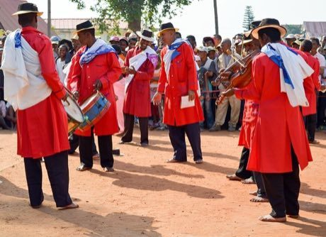

# Hira gasy village troupe contest

*Hira gasy*

**Encyclopedia ID 205** (permanent) · https://equalinformation.com/world-heritage-games-site/games/205-hira-gasy-village-troupe-contest/

*Photo: Rakotovaogael, [CC BY-SA 4.0](https://creativecommons.org/licenses/by-sa/4.0/), [source on Wikimedia Commons](https://commons.wikimedia.org/wiki/File:Hira_Gasy_musicians_playing_drums_and_violins_in_Madagascar.jpg)*

Lead a troupe of drummers, violinists, singers and dancers in tight call-and-response turns, matching beats and moves to score against a rival troupe before the crowd.

## Heritage note

Part of the living heritage of Madagascar. Some forms of this practice carry deep meaning for the communities who keep it; here we describe the play and the craft only, with respect for its roots.

## Origins

A living tradition passed from person to person; it is not tied to a single dated origin. It belongs to the cultural world of Africa: Great Lakes and Indian Ocean.

## Facts

- **Where:** Madagascar
- **Type:** Performance and storytelling
- **Family:** String instruments
- **Era:** [Living Traditions](../../eras/living/index.md)
- **Cradle:** [Africa: Great Lakes and Indian Ocean](../../cradles/africa-east/index.md)
- **Region:** Sub-Saharan Africa

## Related entries

- [Babatone](../../games/1233-babatone/index.md)
- [Valiha tube zither](../../games/124-valiha-tube-zither/index.md)
- [Santur Hammer Strings](../../games/138-santur-hammer-strings/index.md)
- [Dan bau](../../games/143-dan-bau/index.md)
- [Santoor](../../games/151-santoor/index.md)
- [Goje One-String Fiddle](../../games/176-goje-one-string-fiddle/index.md)

## Sources

- <https://commons.wikimedia.org/wiki/File:Hira_Gasy_musicians_playing_drums_and_violins_in_Madagascar.jpg>
