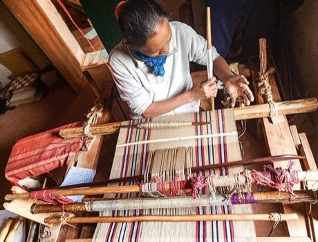

# Malagasy lamba silk weaving

*Lamba landy / akotifahana*

**Encyclopedia ID 206** (permanent) · https://equalinformation.com/world-heritage-games-site/games/206-malagasy-lamba-silk-weaving/

*Photo: RAKOTOBLUE, [CC BY-SA 4.0](https://creativecommons.org/licenses/by-sa/4.0/), [source on Wikimedia Commons](https://commons.wikimedia.org/wiki/File:Traditional_silk_weaving.jpg)*

Pass the shuttle through coloured warp threads to weave stripes and brocade motifs on a ground loom, following (or inventing) a design as the cloth grows.

## Heritage note

A tradition shared by communities in many places. Some forms of this practice carry deep meaning for the communities who keep it; here we describe the play and the craft only, with respect for its roots.

## Origins

A living tradition passed from person to person; it is not tied to a single dated origin.

## Facts

- **Where:** Shared across many places
- **Type:** Crafts and making
- **Family:** Textile and weaving crafts
- **Era:** [Living Traditions](../../eras/living/index.md)
- **Cradle:** [Shared across the world](../../cradles/worldwide/index.md)
- **Region:** Worldwide

## Related entries

- [Kente strip weaving](../../games/22-kente-strip-weaving/index.md)
- [Celtic knot weave](../../games/25-celtic-knot-weave/index.md)
- [Sashiko Stitch Patterns](../../games/27-sashiko-stitch-patterns/index.md)
- [Adire indigo resist dyeing](../../games/87-adire-indigo-resist-dyeing/index.md)
- [Agaseke basket weaving](../../games/89-agaseke-basket-weaving/index.md)
- [Toquilla straw hat weaving](../../games/93-toquilla-straw-hat-weaving/index.md)

## Sources

- <https://commons.wikimedia.org/wiki/File:Traditional_silk_weaving.jpg>
