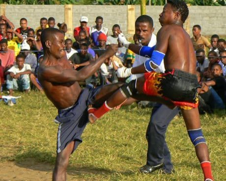

# Moraingy drum-and-strike duel

*Moraingy*

**Encyclopedia ID 207** (permanent) · https://equalinformation.com/world-heritage-games-site/games/207-moraingy-drum-and-strike-duel/

*Photo: Hery Zo Rakotondramanana, [CC BY-SA 2.0](https://creativecommons.org/licenses/by-sa/2.0/), [source on Wikimedia Commons](https://commons.wikimedia.org/wiki/File:Moraingy_fighting_Madagascar_sport.jpg)*

Two stylised fighters trade punches, kicks and dodges to the beat of a drum circle.

## Heritage note

Part of the living heritage of Madagascar. It is presented as sport and skill, never as real fighting.

## Origins

Usually placed in the era of Classical Worlds (about 1000 BCE to 500 CE), although its exact origins are uncertain, within the cultural world of Africa: Great Lakes and Indian Ocean.

## Facts

- **Where:** Madagascar
- **Type:** Wrestling and martial sports
- **Family:** Tag, chase and hide games
- **Era:** [Classical Worlds](../../eras/classical/index.md) (uncertain)
- **Cradle:** [Africa: Great Lakes and Indian Ocean](../../cradles/africa-east/index.md)
- **Region:** Sub-Saharan Africa
- **Players:** 2

## Related entries

- [Circle Dodgeball](../../games/470-circle-dodgeball/index.md)
- [Al Ayyala Cane-Line Rhythm](../../games/1272-al-ayyala-cane-line-rhythm/index.md)
- [Kalinda Stick Duel](../../games/1467-kalinda-stick-duel/index.md)
- [Kyz Kuu](../../games/858-kyz-kuu/index.md)
- [Valiha tube zither](../../games/124-valiha-tube-zither/index.md)
- [Kwepena](../../games/1174-kwepena/index.md)

## Sources

- <https://commons.wikimedia.org/wiki/File:Moraingy_fighting_Madagascar_sport.jpg>
- <https://en.wikipedia.org/wiki/List_of_traditional_games_in_Africa>
