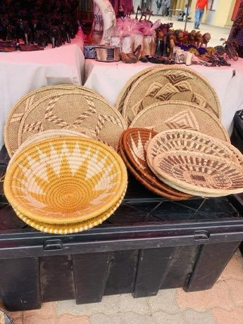

# Botswana coil basket weaving

*Also known as: Gumare · Etsha baskets (ikalanga, Hambukushu coil style)*

**Encyclopedia ID 208** (permanent) · https://bpupadhyaya.github.io/world-heritage-games-site/games/208-botswana-coil-basket-weaving/

*Photo: OtengPortia, [CC0](https://creativecommons.org/publicdomain/zero/1.0/), [source on Wikimedia Commons](https://commons.wikimedia.org/wiki/File:Weaves_and_colors_of_culture.jpg)*

Coil dyed palm strips into a bowl and choose patterns (like river, tears of giraffe, python tracks) so repeating motifs line up around the curve.

## Heritage note

A tradition shared by communities in many places.

## Origins

A living tradition passed from person to person; it is not tied to a single dated origin.

## Facts

- **Where:** Shared across many places
- **Type:** Crafts and making
- **Family:** Textile and weaving crafts
- **Era:** [Living Traditions](../../eras/living/index.md)
- **Cradle:** [Shared across the world](../../cradles/worldwide/index.md)
- **Region:** Worldwide

## Related entries

- [Kente strip weaving](../../games/22-kente-strip-weaving/index.md)
- [Celtic knot weave](../../games/25-celtic-knot-weave/index.md)
- [Sashiko Stitch Patterns](../../games/27-sashiko-stitch-patterns/index.md)
- [Adire indigo resist dyeing](../../games/87-adire-indigo-resist-dyeing/index.md)
- [Agaseke basket weaving](../../games/89-agaseke-basket-weaving/index.md)
- [Toquilla straw hat weaving](../../games/93-toquilla-straw-hat-weaving/index.md)

## Sources

- <https://commons.wikimedia.org/wiki/File:Weaves_and_colors_of_culture.jpg>
