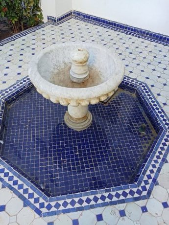

# Zellij tile mosaic

*Also known as: Zellij · Zellige (Arabic)*

**Encyclopedia ID 21** (permanent) · https://bpupadhyaya.github.io/world-heritage-games-site/games/21-zellij-tile-mosaic/

*Photo: Samira hiba, [CC BY 4.0](https://creativecommons.org/licenses/by/4.0/), [source on Wikimedia Commons](https://commons.wikimedia.org/wiki/File:نافورة_بالفسيفساء_والزليج_المغربي.jpg)*

Cut and place glazed tile pieces into their star-and-polygon geometry to fill a panel or fountain floor; later panels need rotating, mirroring and symmetry choices.

## Heritage note

Part of the living heritage of Morocco. Some forms of this practice carry deep meaning for the communities who keep it; here we describe the play and the craft only, with respect for its roots.

## Origins

A living tradition passed from person to person; it is not tied to a single dated origin. It belongs to the cultural world of Mediterranean.

## Facts

- **Where:** Morocco
- **Type:** Crafts and making
- **Family:** Pottery, wood and metal crafts
- **Era:** [Living Traditions](../../eras/living/index.md)
- **Cradle:** [Mediterranean](../../cradles/mediterranean/index.md)
- **Region:** Middle East and North Africa

## Related entries

- [Glassblowing](../../games/121-glassblowing/index.md)
- [Azulejo tile painting](../../games/122-azulejo-tile-painting/index.md)
- [Txalaparta Duet](../../games/390-txalaparta-duet/index.md)
- [Tessellated Mosaic Making](../../games/500-tessellated-mosaic-making/index.md)
- [Swahili carved door](../../games/90-swahili-carved-door/index.md)
- [Thai fruit and vegetable carving](../../games/114-thai-fruit-and-vegetable-carving/index.md)

## Sources

- <https://commons.wikimedia.org/wiki/File:نافورة_بالفسيفساء_والزليج_المغربي.jpg>
