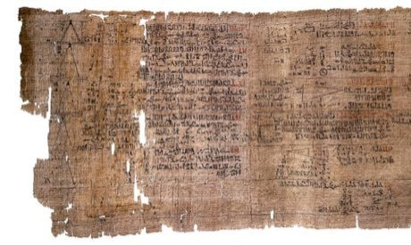

# Egyptian Fractions and Doubling

*Also known as: Rhind papyrus problems*

**Encyclopedia ID 215** (permanent) · https://bpupadhyaya.github.io/world-heritage-games-site/games/215-egyptian-fractions-and-doubling/

*Photo: unknown (c. 1550 BC scribe), [Public domain](https://creativecommons.org/publicdomain/mark/1.0/), [source on Wikimedia Commons](https://commons.wikimedia.org/wiki/File%3ARhind_Mathematical_Papyrus.jpg)*

Split loaves among workers using only unit fractions, and multiply by repeated doubling like a scribe.

## Heritage note

Part of the living heritage of Egypt.

## Origins

Usually placed in the era of Modern Heritage (1800 to today), although its exact origins are uncertain, within the cultural world of Africa: Nile and the Horn.

## Facts

- **Where:** Egypt
- **Type:** Puzzles and mind games
- **Family:** Puzzle and dexterity toys
- **Era:** [Modern Heritage](../../eras/modern/index.md) (uncertain)
- **Cradle:** [Africa: Nile and the Horn](../../cradles/africa-nile/index.md)
- **Region:** Middle East and North Africa

## Related entries

- [Kingyo-sukui](../../games/3-kingyo-sukui/index.md)
- [Stone Skipping](../../games/5-stone-skipping/index.md)
- [Disc-flip](../../games/8-disc-flip/index.md)
- [Sjoelen](../../games/9-sjoelen/index.md)
- [Shove ha'penny](../../games/54-shove-hapenny/index.md)
- [Limbo](../../games/58-limbo/index.md)

## Sources

- <https://commons.wikimedia.org/wiki/File%3ARhind_Mathematical_Papyrus.jpg>
