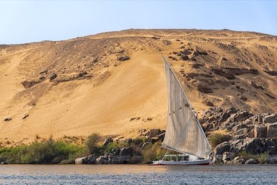

# Nile Felucca Sailing

*Also known as: felucca*

**Encyclopedia ID 216** (permanent) · https://bpupadhyaya.github.io/world-heritage-games-site/games/216-nile-felucca-sailing/

*Photo: Mustang Joe, [CC0](https://creativecommons.org/publicdomain/zero/1.0/), [source on Wikimedia Commons](https://commons.wikimedia.org/wiki/File%3AFelucca_on_the_Nile_%2853709847874%29.jpg)*

Trim the lateen sail to the changing Nile wind and current to carry cargo and passengers between river towns.

## Heritage note

Part of the living heritage of Egypt.

## Origins

Usually placed in the era of Age of Contact and Craft (about 1500 to 1800), although its exact origins are uncertain, within the cultural world of Africa: Nile and the Horn.

## Facts

- **Where:** Egypt
- **Type:** Racing
- **Family:** Water sports
- **Era:** [Age of Contact and Craft](../../eras/contact/index.md) (uncertain)
- **Cradle:** [Africa: Nile and the Horn](../../cradles/africa-nile/index.md)
- **Region:** Middle East and North Africa

## Related entries

- [Nouka Baich](../../games/42-nouka-baich/index.md)
- [Pirogue coastal canoe race](../../games/56-pirogue-coastal-canoe-race/index.md)
- [Shikara paddle race](../../games/265-shikara-paddle-race/index.md)
- [Hanetsuki](../../games/347-hanetsuki/index.md)
- [Venetian lagoon regatta](../../games/486-venetian-lagoon-regatta/index.md)
- [Ngalawa outrigger sailing](../../games/1259-ngalawa-outrigger-sailing/index.md)

## Sources

- <https://commons.wikimedia.org/wiki/File%3AFelucca_on_the_Nile_%2853709847874%29.jpg>
