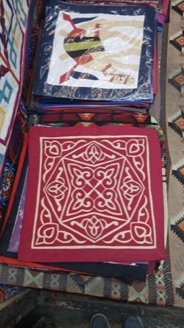

# Khayamiya Tentmaker Applique

*khayamiya / خيامية*

**Encyclopedia ID 217** (permanent) · https://equalinformation.com/world-heritage-games-site/games/217-khayamiya-tentmaker-applique/

*Photo: Mo Hany.Afife, [Public domain](https://creativecommons.org/publicdomain/mark/1.0/), [source on Wikimedia Commons](https://commons.wikimedia.org/wiki/File%3AView_from_Khayamiya_%28Tentmakers%29_Street_in_Cairo_08.jpg)*

Trace a geometric design, cut cloth pieces and stitch layers to build a panel.

## Heritage note

Part of the living heritage of Egypt. Some forms of this practice carry deep meaning for the communities who keep it; here we describe the play and the craft only, with respect for its roots.

## Origins

A living tradition passed from person to person; it is not tied to a single dated origin. It belongs to the cultural world of Africa: Nile and the Horn.

## Facts

- **Where:** Egypt
- **Type:** Crafts and making
- **Family:** Paper, ink and painting crafts
- **Era:** [Living Traditions](../../eras/living/index.md)
- **Cradle:** [Africa: Nile and the Horn](../../cradles/africa-nile/index.md)
- **Region:** Middle East and North Africa

## Related entries

- [Nubian house painting](../../games/192-nubian-house-painting/index.md)
- [Dinka beaded corset beadwork](../../games/1269-dinka-beaded-corset-beadwork/index.md)
- [Ebru paper marbling](../../games/20-ebru-paper-marbling/index.md)
- [Ndebele geometric wall painting](../../games/23-ndebele-geometric-wall-painting/index.md)
- [Chinese knotting](../../games/26-chinese-knotting/index.md)
- [Matryoshka](../../games/28-matryoshka/index.md)

## Sources

- <https://commons.wikimedia.org/wiki/File%3AView_from_Khayamiya_%28Tentmakers%29_Street_in_Cairo_08.jpg>
