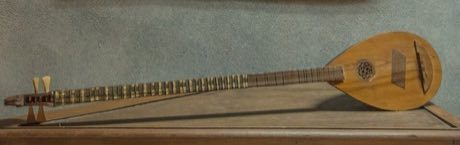

# Buzuq Long-Neck Lute

*buzuq / بزق*

**Encyclopedia ID 218** (permanent) · https://equalinformation.com/world-heritage-games-site/games/218-buzuq-long-neck-lute/

*Photo: IssamBarhoumi, [CC BY-SA 4.0](https://creativecommons.org/licenses/by-sa/4.0/), [source on Wikimedia Commons](https://commons.wikimedia.org/wiki/File%3ABuzuk_-_Collection_des_instruments_de_musique_du_Baron_d%27Erlanger_%28cropped%29.jpg)*

Pluck and slide along a long fretless neck to play folk melodies with quarter-tone steps and tremolo.

## Heritage note

Part of the living heritage of Lebanon, Syria, Palestine.

## Origins

Usually placed in the era of Crossroads and Golden Ages (about 500 to 1500), although its exact origins are uncertain, within the cultural world of Mesopotamia, Levant and Arabia.

## Facts

- **Where:** Lebanon, Syria, Palestine
- **Type:** Musical instruments
- **Family:** String instruments
- **Era:** [Crossroads and Golden Ages](../../eras/crossroads/index.md) (uncertain)
- **Cradle:** [Mesopotamia, Levant and Arabia](../../cradles/mesopotamia-levant/index.md)
- **Region:** Middle East and North Africa

## Related entries

- [Saz / Bağlama](../../games/243-saz-baglama/index.md)
- [Dombra](../../games/48-dombra/index.md)
- [Charango](../../games/55-charango/index.md)
- [Erhu Two-String Fiddle](../../games/139-erhu-two-string-fiddle/index.md)
- [Komuz](../../games/242-komuz/index.md)
- [Tar and mugham modes](../../games/247-tar-and-mugham-modes/index.md)

## Sources

- <https://commons.wikimedia.org/wiki/File%3ABuzuk_-_Collection_des_instruments_de_musique_du_Baron_d%27Erlanger_%28cropped%29.jpg>
