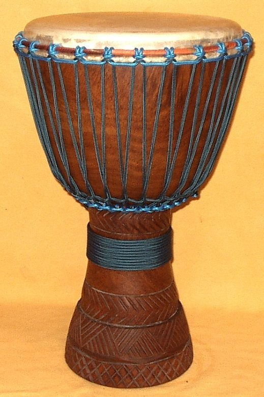

# Djembe

**Encyclopedia ID 2189** (permanent) · https://bpupadhyaya.github.io/world-heritage-games-site/games/2189-djembe/

*Photo: Djembe Art, [CC BY-SA 3.0](https://creativecommons.org/licenses/by-sa/3.0/), [source on Wikimedia Commons](https://commons.wikimedia.org/wiki/File:Lenke_djembe_from_Mali.jpeg)*

The djembe is a goblet-shaped hand drum from West Africa, carved from a single piece of hardwood and covered with a goatskin head. It originated among the Mandinka (Maninka) and Bambara peoples of the old Mali Empire, today's Mali, Guinea and neighbouring countries. A familiar Maninka saying explains its name: 'anke djé, anke bé', meaning 'everyone gather together in peace'. Its sounds range from deep bass to ringing tone and sharp slap, which are all produced by the bare hands.

## How it is played

The drummer wears the djembe from a strap or holds it between the knees and strikes the head with both hands. Striking the centre of the skin with the whole hand gives the deep bass, striking near the rim with the fingers together gives an open tone, and striking at the very edge with relaxed fingers gives the slap. In an ensemble the djembe players are joined by bass drums called dunun, and a lead drummer plays calls and solos over repeating patterns while accompanists hold the rhythm. The group answers, repeats and develops phrases in turn.

## Heritage note

In the Mande world, the making of drums traditionally belongs to the blacksmith families, and the drum is played at weddings, naming days, harvests and community celebrations as well as at big dances. Each rhythm, such as Kuku or Djole, is linked to a particular occasion, dance or group, and mastering the repertoire requires years of apprenticeship. In the 1950s the Guinean company Les Ballets Africains, founded by Fodeba Keita, brought the djembe to international stages, and drummers such as Mamady Keita and Famoudou Konate carried it around the world. Djembe circles are now found in cities across the globe.

## Origins

A Mande instrument from the Mali Empire region of West Africa, with its history before the 20th century known mainly through oral tradition.

## Facts

- **Where:** Guinea, Mali
- **Type:** Musical instruments
- **Family:** Drums and percussion
- **Era:** [Modern Heritage](../../eras/modern/index.md) (uncertain)
- **Cradle:** [Africa: Sahel, West and Central](../../cradles/africa-west/index.md)
- **Region:** Sub-Saharan Africa

## Play it

[Try a 90-second preview in your browser](https://bpupadhyaya.github.io/games-site/games/djembe-drum-circle/play/) · [Google Play](https://play.google.com/store/apps/details?id=com.equalinformation.arcforge.shell) · [App Store](https://apps.apple.com/us/app/arcforge-world-heritage-games/id6813746442)

## Related entries

- [Balafon Gourd Xylophone](../../games/168-balafon-gourd-xylophone/index.md)
- [Sega ravanne drum](../../games/199-sega-ravanne-drum/index.md)
- [Chinchinero Drum Walk](../../games/1406-chinchinero-drum-walk/index.md)
- [Talking drum](../../games/33-talking-drum/index.md)
- [Bozo Net Casting](../../games/169-bozo-net-casting/index.md)
- [Calabash Water Drum](../../games/180-calabash-water-drum/index.md)

## Sources

- <https://en.wikipedia.org/wiki/Djembe>
