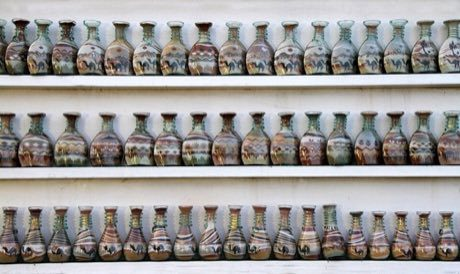

# Jordanian Sand Bottle Art

*Also known as: sand bottles · رمل ملون*

**Encyclopedia ID 219** (permanent) · https://bpupadhyaya.github.io/world-heritage-games-site/games/219-jordanian-sand-bottle-art/

*Photo: Gerd Eichmann, [CC BY-SA 4.0](https://creativecommons.org/licenses/by-sa/4.0/), [source on Wikimedia Commons](https://commons.wikimedia.org/wiki/File%3APetra-40-Sandflaschen-2010-gje.jpg)*

Fill a glass bottle with layers of natural coloured sand, shaping dunes, camels and palms with a thin tool.

## Heritage note

Part of the living heritage of Jordan.

## Origins

A living tradition passed from person to person; it is not tied to a single dated origin. It belongs to the cultural world of Mesopotamia, Levant and Arabia.

## Facts

- **Where:** Jordan
- **Type:** Crafts and making
- **Family:** Paper, ink and painting crafts
- **Era:** [Living Traditions](../../eras/living/index.md)
- **Cradle:** [Mesopotamia, Levant and Arabia](../../cradles/mesopotamia-levant/index.md)
- **Region:** Middle East and North Africa

## Related entries

- [Maamoul Cookie Moulding](../../games/225-maamoul-cookie-moulding/index.md)
- [Ebru paper marbling](../../games/20-ebru-paper-marbling/index.md)
- [Al-Qatt Al-Asiri Wall Painting](../../games/1231-al-qatt-al-asiri-wall-painting/index.md)
- [Keffiyeh Pattern Loom](../../games/1310-keffiyeh-pattern-loom/index.md)
- [Qamariya Gypsum Window Designer](../../games/1368-qamariya-gypsum-window-designer/index.md)
- [Ndebele geometric wall painting](../../games/23-ndebele-geometric-wall-painting/index.md)

## Sources

- <https://commons.wikimedia.org/wiki/File%3APetra-40-Sandflaschen-2010-gje.jpg>
