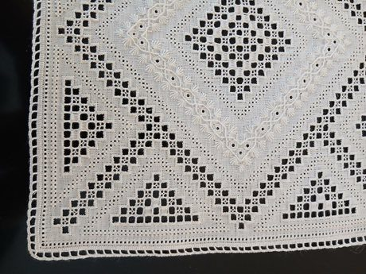

# Lefkara Lace

*Also known as: lefkaritika*

**Encyclopedia ID 220** (permanent) · https://bpupadhyaya.github.io/world-heritage-games-site/games/220-lefkara-lace/

*Photo: LaceDemo1, [CC BY-SA 4.0](https://creativecommons.org/licenses/by-sa/4.0/), [source on Wikimedia Commons](https://commons.wikimedia.org/wiki/File%3ALefkaraLace_example1.jpg)*

Pull threads from linen then stitch geometric fills over the cut squares to reveal diamond and triangle patterns.

## Heritage note

Part of the living heritage of Cyprus.

## Origins

A living tradition passed from person to person; it is not tied to a single dated origin. It belongs to the cultural world of Mediterranean.

## Facts

- **Where:** Cyprus
- **Type:** Crafts and making
- **Family:** Textile and weaving crafts
- **Era:** [Living Traditions](../../eras/living/index.md)
- **Cradle:** [Mediterranean](../../cradles/mediterranean/index.md)
- **Region:** Europe

## Related entries

- [Amazigh Rug Weaving](../../games/224-amazigh-rug-weaving/index.md)
- [Chechia Felt-Cap Workshop](../../games/1254-chechia-felt-cap-workshop/index.md)
- [Plis Cap Felter](../../games/1362-plis-cap-felter/index.md)
- [Kente strip weaving](../../games/22-kente-strip-weaving/index.md)
- [Celtic knot weave](../../games/25-celtic-knot-weave/index.md)
- [Sashiko Stitch Patterns](../../games/27-sashiko-stitch-patterns/index.md)

## Sources

- <https://commons.wikimedia.org/wiki/File%3ALefkaraLace_example1.jpg>
