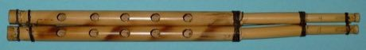

# Mijwiz Double Clarinet

*mijwiz / مجوز*

**Encyclopedia ID 221** (permanent) · https://bpupadhyaya.github.io/world-heritage-games-site/games/221-mijwiz-double-clarinet/

*Photo: Sönke Kraft aka Arnulf zu Linden, [CC BY-SA 3.0](https://creativecommons.org/licenses/by-sa/3.0/), [source on Wikimedia Commons](https://commons.wikimedia.org/wiki/File%3AMijwiz.jpg)*

Blow a steady breath while sliding fingers over twin reed pipes, holding a drone and playing dabke tunes.

## Heritage note

Part of the living heritage of Lebanon, Syria, Palestine.

## Origins

A living tradition passed from person to person; it is not tied to a single dated origin. It belongs to the cultural world of Mesopotamia, Levant and Arabia.

## Facts

- **Where:** Lebanon, Syria, Palestine, Jordan
- **Type:** Musical instruments
- **Family:** Wind instruments
- **Era:** [Living Traditions](../../eras/living/index.md)
- **Cradle:** [Mesopotamia, Levant and Arabia](../../cradles/mesopotamia-levant/index.md)
- **Region:** Middle East and North Africa

## Related entries

- [Mudhif reed-arch house](../../games/230-mudhif-reed-arch-house/index.md)
- [Cuneiform Clay Tablet Scribe](../../games/1260-cuneiform-clay-tablet-scribe/index.md)
- [Khene](../../games/145-khene/index.md)
- [Lusheng](../../games/337-lusheng/index.md)
- [Launeddas Triple Pipe](../../games/400-launeddas-triple-pipe/index.md)
- [Rubboard zydeco rhythm](../../games/437-rubboard-zydeco-rhythm/index.md)

## Sources

- <https://commons.wikimedia.org/wiki/File%3AMijwiz.jpg>
