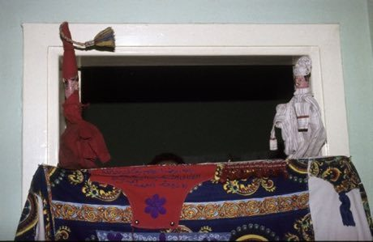

# Aragoz Hand-Puppet Booth

*Also known as: aragoz · أراجوز*

**Encyclopedia ID 222** (permanent) · https://bpupadhyaya.github.io/world-heritage-games-site/games/222-aragoz-hand-puppet-booth/

*Photo: Carel van Leeuwen / Tropenmuseum, [CC BY-SA 3.0](https://creativecommons.org/licenses/by-sa/3.0/), [source on Wikimedia Commons](https://commons.wikimedia.org/wiki/File%3ACOLLECTIE_TROPENMUSEUM_Araguz-spel_in_het_huis_van_poppenspeler_Said_Masri_Mohammed_TMnr_20043358.jpg)*

Raise glove puppets over a booth front and choose jokes, voices and squeaker whistle to carry a comic street tale.

## Heritage note

Part of the living heritage of Egypt.

## Origins

Usually placed in the era of Classical Worlds (about 1000 BCE to 500 CE), although its exact origins are uncertain, within the cultural world of Africa: Nile and the Horn.

## Facts

- **Where:** Egypt
- **Type:** Performance and storytelling
- **Family:** Puppetry and shadow play
- **Era:** [Classical Worlds](../../eras/classical/index.md) (uncertain)
- **Cradle:** [Africa: Nile and the Horn](../../cradles/africa-nile/index.md)
- **Region:** Middle East and North Africa

## Related entries

- [Water puppet pond theatre](../../games/303-water-puppet-pond-theatre/index.md)
- [Yoke thé](../../games/314-yoke-the/index.md)
- [Sicilian Puppet Knights](../../games/514-sicilian-puppet-knights/index.md)
- [Krar lyre](../../games/126-krar-lyre/index.md)
- [Zande kundi arched harp](../../games/1319-zande-kundi-arched-harp/index.md)
- [Tahtib](../../games/157-tahtib/index.md)

## Sources

- <https://commons.wikimedia.org/wiki/File%3ACOLLECTIE_TROPENMUSEUM_Araguz-spel_in_het_huis_van_poppenspeler_Said_Masri_Mohammed_TMnr_20043358.jpg>
