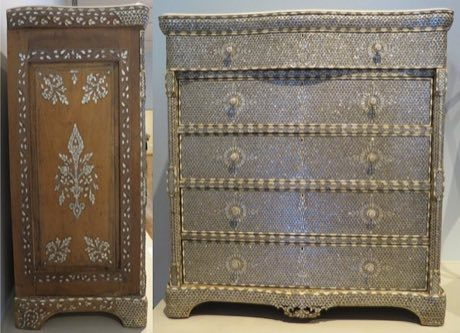

# Damascus Mother-of-Pearl Inlay

*Also known as: sadaf · صدف*

**Encyclopedia ID 223** (permanent) · https://bpupadhyaya.github.io/world-heritage-games-site/games/223-damascus-mother-of-pearl-inlay/

*Photo: Hiart, [CC0](https://creativecommons.org/publicdomain/zero/1.0/), [source on Wikimedia Commons](https://commons.wikimedia.org/wiki/File%3ADresser_from_Damascus%2C_Syria%2C_19th_century%2C_wood%2C_mother-of-pearl%2C_metal_wire_and_plated_copper_alloy%2C_HAA.JPG)*

Cut shell pieces to a pattern and set them into carved wood, matching each piece to its slot.

## Heritage note

Part of the living heritage of Syria.

## Origins

A living tradition passed from person to person; it is not tied to a single dated origin. It belongs to the cultural world of Mesopotamia, Levant and Arabia.

## Facts

- **Where:** Syria
- **Type:** Crafts and making
- **Family:** Pottery, wood and metal crafts
- **Era:** [Living Traditions](../../eras/living/index.md)
- **Cradle:** [Mesopotamia, Levant and Arabia](../../cradles/mesopotamia-levant/index.md)
- **Region:** Middle East and North Africa

## Related entries

- [Iznik tile painting](../../games/244-iznik-tile-painting/index.md)
- [Omani Khanjar Silver Filigree](../../games/1351-omani-khanjar-silver-filigree/index.md)
- [Hebron Glassblowing](../../games/6034-hebron-glassblowing/index.md)
- [Zellij tile mosaic](../../games/21-zellij-tile-mosaic/index.md)
- [Thai fruit and vegetable carving](../../games/114-thai-fruit-and-vegetable-carving/index.md)
- [Glassblowing](../../games/121-glassblowing/index.md)

## Sources

- <https://commons.wikimedia.org/wiki/File%3ADresser_from_Damascus%2C_Syria%2C_19th_century%2C_wood%2C_mother-of-pearl%2C_metal_wire_and_plated_copper_alloy%2C_HAA.JPG>
