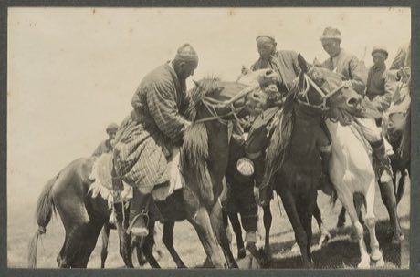

# Buzkashi

*Also known as: بزکشی · Kupkari (Ulak, goat-grabbing) · Ulak*

**Encyclopedia ID 226** (permanent) · https://bpupadhyaya.github.io/world-heritage-games-site/games/226-buzkashi/

*Photo: Sir Percy Sykes, 1867-1945, [Public domain](https://creativecommons.org/publicdomain/mark/1.0/), [source on Wikimedia Commons](https://commons.wikimedia.org/wiki/File:Men_playing_Buzkashi.jpg)*

Ride in a chaotic scrum, scoop a heavy dummy "calf" from the ground without dropping it, and carry it round a flag and into the scoring circle before rivals strip it from you.

## Heritage note

Part of the living heritage of Afghanistan. Animals are partners in this tradition; good care and local rules always come first.

## Origins

Usually placed in the era of Classical Worlds (about 1000 BCE to 500 CE), although its exact origins are uncertain, within the cultural world of Persia, Caucasus and Central Asia.

## Facts

- **Where:** Afghanistan, Uzbekistan
- **Type:** Dexterity and skill games
- **Family:** Hunt and blockade games
- **Era:** [Classical Worlds](../../eras/classical/index.md) (uncertain)
- **Cradle:** [Persia, Caucasus and Central Asia](../../cradles/persia-central-asia/index.md)
- **Region:** South and Central Asia
- **Players:** teams of riders

## Play it

[Try a 90-second preview in your browser](https://bpupadhyaya.github.io/games-site/games/buzkashi/play/) · [Google Play](https://play.google.com/store/apps/details?id=com.equalinformation.arcforge.shell) · App Store (coming soon)

## Related entries

- [Kok-boru](../../games/241-kok-boru/index.md)
- [Kokpar](../../games/857-kokpar/index.md)
- [Silk Road caravan trade](../../games/22339-silk-road-caravan-trade/index.md)
- [Chavgon](../../games/1204-chavgon/index.md)
- [Shashki / chess](../../games/1206-shashki-chess/index.md)
- [Mheibes](../../games/158-mheibes/index.md)

## Sources

- <https://commons.wikimedia.org/wiki/File:Men_playing_Buzkashi.jpg>
- <https://people-travels.com/countries/uzbekistan-additional/uzbek-traditional-games-and-amusements>
- <https://www.advantour.com/uzbekistan/traditions/kupkari.htm>
