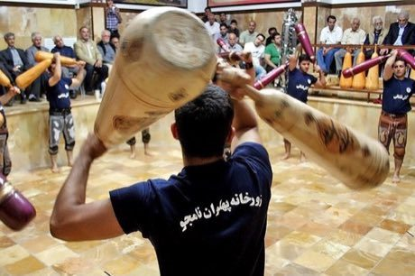

# Zurkhaneh strength rhythm

*Also known as: ورزش باستانی · Pahlavani club*

**Encyclopedia ID 227** (permanent) · https://bpupadhyaya.github.io/world-heritage-games-site/games/227-zurkhaneh-strength-rhythm/

*Photo: Reza Dehshiri, [CC BY 4.0](https://creativecommons.org/licenses/by/4.0/), [source on Wikimedia Commons](https://commons.wikimedia.org/wiki/File:Tehran_Zurkhaneh_(2).jpg)*

Swing heavy wooden clubs, spin and lift in time with a drummer's beat.

## Heritage note

Part of the living heritage of Iran. Some forms of this practice carry deep meaning for the communities who keep it; here we describe the play and the craft only, with respect for its roots.

## Origins

Usually placed in the era of Modern Heritage (1800 to today), although its exact origins are uncertain, within the cultural world of Persia, Caucasus and Central Asia.

## Facts

- **Where:** Iran
- **Type:** Dexterity and skill games
- **Family:** Winter sports
- **Era:** [Modern Heritage](../../eras/modern/index.md) (uncertain)
- **Cradle:** [Persia, Caucasus and Central Asia](../../cradles/persia-central-asia/index.md)
- **Region:** Middle East and North Africa

## Play it

[Web preview](https://bpupadhyaya.github.io/) · [Google Play](https://play.google.com/store/apps/details?id=com.equalinformation.arcforge.shell) · [App Store](https://apps.apple.com/us/app/arcforge-world-heritage-games/id6813746442)

## Related entries

- [Chinlone](../../games/16-chinlone/index.md)
- [Pinata swing](../../games/61-pinata-swing/index.md)
- [Ring Tilting](../../games/65-ring-tilting/index.md)
- [Yukigassen Snow Fort](../../games/71-yukigassen-snow-fort/index.md)
- [Bagatelle](../../games/72-bagatelle/index.md)
- [Plate Spinning](../../games/73-plate-spinning/index.md)

## Sources

- <https://commons.wikimedia.org/wiki/File:Tehran_Zurkhaneh_(2).jpg>
