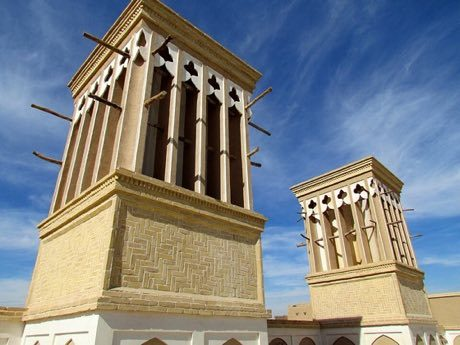

# Badgir windcatcher cooling puzzle

*Also known as: بادگیر*

**Encyclopedia ID 229** (permanent) · https://bpupadhyaya.github.io/world-heritage-games-site/games/229-badgir-windcatcher-cooling-puzzle/

*Photo: Alireza Javaheri, [CC BY 3.0](https://creativecommons.org/licenses/by/3.0/), [source on Wikimedia Commons](https://commons.wikimedia.org/wiki/File:Yazd_-_Badgir_-_Windcatcher_-_panoramio.jpg)*

Shape the tower openings, shafts and a water pool so desert wind flows down and cools rooms; route air to every room with limited bricks.

## Heritage note

Part of the living heritage of Iran.

## Origins

A living tradition passed from person to person; it is not tied to a single dated origin. It belongs to the cultural world of Persia, Caucasus and Central Asia.

## Facts

- **Where:** Iran
- **Type:** Crafts and making
- **Era:** [Living Traditions](../../eras/living/index.md)
- **Cradle:** [Persia, Caucasus and Central Asia](../../cradles/persia-central-asia/index.md)
- **Region:** Middle East and North Africa

## Related entries

- [Santur Hammer Strings](../../games/138-santur-hammer-strings/index.md)
- [Persian Carpet Knotting](../../games/161-persian-carpet-knotting/index.md)
- [Kamancha](../../games/165-kamancha/index.md)
- [Muqarnas stalactite vault builder](../../games/228-muqarnas-stalactite-vault-builder/index.md)
- [Khatam inlay star pattern workshop](../../games/231-khatam-inlay-star-pattern-workshop/index.md)
- [Tombak goblet drum rhythms](../../games/233-tombak-goblet-drum-rhythms/index.md)

## Sources

- <https://commons.wikimedia.org/wiki/File:Yazd_-_Badgir_-_Windcatcher_-_panoramio.jpg>
