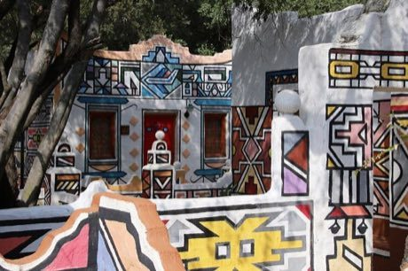

# Ndebele geometric wall painting

*Also known as: Ndebele house painting*

**Encyclopedia ID 23** (permanent) · https://bpupadhyaya.github.io/world-heritage-games-site/games/23-ndebele-geometric-wall-painting/

*Photo: Angela Abel, [CC BY 4.0](https://creativecommons.org/licenses/by/4.0/), [source on Wikimedia Commons](https://commons.wikimedia.org/wiki/File:Ndebele_Architecture.jpg)*

Choose bold black outlines and paint bright flat colour fields on a house facade and wall, matching or inventing symmetrical geometric motifs.

## Heritage note

Part of the living heritage of South Africa.

## Origins

A living tradition passed from person to person; it is not tied to a single dated origin. It belongs to the cultural world of Africa: Southern Africa.

## Facts

- **Where:** South Africa
- **Type:** Crafts and making
- **Family:** Paper, ink and painting crafts
- **Era:** [Living Traditions](../../eras/living/index.md)
- **Cradle:** [Africa: Southern Africa](../../cradles/africa-south/index.md)
- **Region:** Sub-Saharan Africa

## Related entries

- [Zulu beadwork letters](../../games/88-zulu-beadwork-letters/index.md)
- [Basotho blanket pattern designer](../../games/201-basotho-blanket-pattern-designer/index.md)
- [Capulana wrap cloth printing and tying](../../games/204-capulana-wrap-cloth-printing-and-tying/index.md)
- [Ebru paper marbling](../../games/20-ebru-paper-marbling/index.md)
- [Chinese knotting](../../games/26-chinese-knotting/index.md)
- [Matryoshka](../../games/28-matryoshka/index.md)

## Sources

- <https://commons.wikimedia.org/wiki/File:Ndebele_Architecture.jpg>
