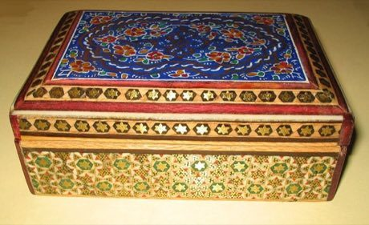

# Khatam inlay star pattern workshop

*Also known as: خاتم‌کاری*

**Encyclopedia ID 231** (permanent) · https://bpupadhyaya.github.io/world-heritage-games-site/games/231-khatam-inlay-star-pattern-workshop/

*Photo: Fabienkhan, [Public domain](https://creativecommons.org/publicdomain/mark/1.0/), [source on Wikimedia Commons](https://commons.wikimedia.org/wiki/File:Boite_khatam.jpg)*

Cut tiny triangles of metal, bone and wood and slot them into a star-pattern mosaic, matching sticks of different colours until a box lid is covered.

## Heritage note

Part of the living heritage of Iran.

## Origins

A living tradition passed from person to person; it is not tied to a single dated origin. It belongs to the cultural world of Persia, Caucasus and Central Asia.

## Facts

- **Where:** Iran
- **Type:** Crafts and making
- **Family:** Pottery, wood and metal crafts
- **Era:** [Living Traditions](../../eras/living/index.md)
- **Cradle:** [Persia, Caucasus and Central Asia](../../cradles/persia-central-asia/index.md)
- **Region:** Middle East and North Africa

## Related entries

- [Minakari](../../games/6007-minakari/index.md)
- [Rishtan ceramics](../../games/252-rishtan-ceramics/index.md)
- [Pamiri House Ceiling Raiser](../../games/1356-pamiri-house-ceiling-raiser/index.md)
- [Turkmen Silver Jewelry Designer](../../games/1392-turkmen-silver-jewelry-designer/index.md)
- [Zellij tile mosaic](../../games/21-zellij-tile-mosaic/index.md)
- [Thai fruit and vegetable carving](../../games/114-thai-fruit-and-vegetable-carving/index.md)

## Sources

- <https://commons.wikimedia.org/wiki/File:Boite_khatam.jpg>
