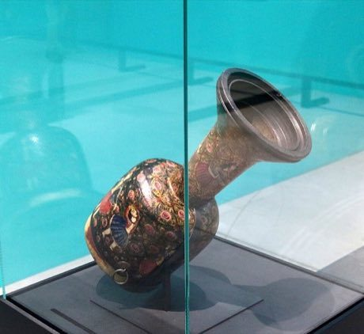

# Tombak goblet drum rhythms

*Also known as: تنبک · zarb*

**Encyclopedia ID 233** (permanent) · https://bpupadhyaya.github.io/world-heritage-games-site/games/233-tombak-goblet-drum-rhythms/

*Photo: PersianDutchNetwork, [CC BY-SA 4.0](https://creativecommons.org/licenses/by-sa/4.0/), [source on Wikimedia Commons](https://commons.wikimedia.org/wiki/File:Persian_percussion_instrument_TOMBAK.jpg)*

Strike fingertip, palm and rim zones of the drum in time with traditional patterns, echoing the master's phrase, then improvise a call and response.

## Heritage note

Part of the living heritage of Iran.

## Origins

A living tradition passed from person to person; it is not tied to a single dated origin. It belongs to the cultural world of Persia, Caucasus and Central Asia.

## Facts

- **Where:** Iran
- **Type:** Musical instruments
- **Family:** Drums and percussion
- **Era:** [Living Traditions](../../eras/living/index.md)
- **Cradle:** [Persia, Caucasus and Central Asia](../../cradles/persia-central-asia/index.md)
- **Region:** Middle East and North Africa

## Related entries

- [Talking drum](../../games/33-talking-drum/index.md)
- [Tabla Bol Rhythm](../../games/35-tabla-bol-rhythm/index.md)
- [Marimba](../../games/52-marimba/index.md)
- [Calabash Water Drum](../../games/180-calabash-water-drum/index.md)
- [Amadinda and embaire](../../games/185-amadinda-and-embaire/index.md)
- [Isukuti drum dance](../../games/191-isukuti-drum-dance/index.md)

## Sources

- <https://commons.wikimedia.org/wiki/File:Persian_percussion_instrument_TOMBAK.jpg>
