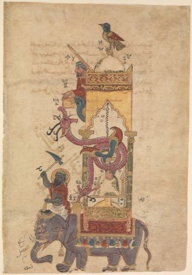

# Al-Jazari water-clock contraptions

*الجزري · Ingenious Devices*

**Encyclopedia ID 237** (permanent) · https://equalinformation.com/world-heritage-games-site/games/237-al-jazari-water-clock-contraptions/

*Photo: al-Jazari, [CC0](https://creativecommons.org/publicdomain/zero/1.0/), [source on Wikimedia Commons](https://commons.wikimedia.org/wiki/File:%22The_Elephant_Clock%22,_Folio_from_a_Book_of_the_Knowledge_of_Ingenious_Mechanical_Devices_by_al-Jazari_MET_DP234075.jpg)*

Wire up floats, pipes, cams and levers in a drawing to make an elephant clock, peacock fountain or musical automaton run its show.

## Heritage note

Part of the living heritage of Iraq.

## Origins

Usually placed in the era of Modern Heritage (1800 to today), although its exact origins are uncertain, within the cultural world of Mesopotamia, Levant and Arabia.

## Facts

- **Where:** Iraq
- **Type:** Puzzles and mind games
- **Family:** Puzzle and dexterity toys
- **Era:** [Modern Heritage](../../eras/modern/index.md) (uncertain)
- **Cradle:** [Mesopotamia, Levant and Arabia](../../cradles/mesopotamia-levant/index.md)
- **Region:** Middle East and North Africa

## Related entries

- [Hama Noria Waterwheels](../../games/1295-hama-noria-waterwheels/index.md)
- [Phoenician Alphabet Trader](../../games/1359-phoenician-alphabet-trader/index.md)
- [Kingyo-sukui](../../games/3-kingyo-sukui/index.md)
- [Stone Skipping](../../games/5-stone-skipping/index.md)
- [Disc-flip](../../games/8-disc-flip/index.md)
- [Sjoelen](../../games/9-sjoelen/index.md)

## Sources

- <https://commons.wikimedia.org/wiki/File:%22The_Elephant_Clock%22,_Folio_from_a_Book_of_the_Knowledge_of_Ingenious_Mechanical_Devices_by_al-Jazari_MET_DP234075.jpg>
