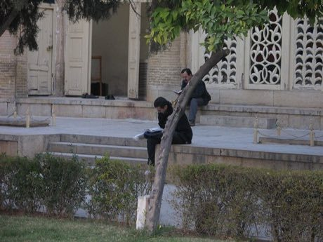

# Bayt-bazi: verse chain

*بیت‌بازی · poetry-link word game*

**Encyclopedia ID 240** (permanent) · https://equalinformation.com/world-heritage-games-site/games/240-bayt-bazi-verse-chain/

*Photo: Ivan Mlinaric from Slovenia, [CC BY 2.0](https://creativecommons.org/licenses/by/2.0/), [source on Wikimedia Commons](https://commons.wikimedia.org/wiki/File:People_reading_Hafez_poetry_(2151305285).jpg)*

Each side must give a line that starts with the last letter of the previous verse; a chain continues until someone runs out.

## Heritage note

Part of the living heritage of Iran.

## Origins

A living tradition passed from person to person; it is not tied to a single dated origin. It belongs to the cultural world of Persia, Caucasus and Central Asia.

## Facts

- **Where:** Iran
- **Type:** Performance and storytelling
- **Era:** [Living Traditions](../../eras/living/index.md)
- **Cradle:** [Persia, Caucasus and Central Asia](../../cradles/persia-central-asia/index.md)
- **Region:** Middle East and North Africa

## Related entries

- [Santur Hammer Strings](../../games/138-santur-hammer-strings/index.md)
- [Persian Carpet Knotting](../../games/161-persian-carpet-knotting/index.md)
- [Muqarnas stalactite vault builder](../../games/228-muqarnas-stalactite-vault-builder/index.md)
- [Badgir windcatcher cooling puzzle](../../games/229-badgir-windcatcher-cooling-puzzle/index.md)
- [Khatam inlay star pattern workshop](../../games/231-khatam-inlay-star-pattern-workshop/index.md)
- [Tombak goblet drum rhythms](../../games/233-tombak-goblet-drum-rhythms/index.md)

## Sources

- <https://commons.wikimedia.org/wiki/File:People_reading_Hafez_poetry_(2151305285).jpg>
