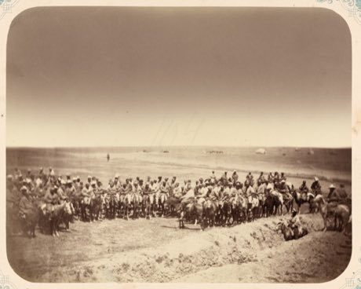

# Kok-boru

*Also known as: Көк бөрү · Ulak-tartysh, goat polo*

**Encyclopedia ID 241** (permanent) · https://bpupadhyaya.github.io/world-heritage-games-site/games/241-kok-boru/

*Photo: Helen Owl, [CC BY-SA 4.0](https://creativecommons.org/licenses/by-sa/4.0/), [source on Wikimedia Commons](https://commons.wikimedia.org/wiki/File:Kok-boru_2018.jpg)*

Two mounted teams carry and throw a weighted goat-hide ball into the opposing goal ring, steering, shoving and passing at the gallop.

## Heritage note

Part of the living heritage of Kyrgyzstan, Kazakhstan, Tajikistan.

## Origins

Usually placed in the era of Classical Worlds (about 1000 BCE to 500 CE), although its exact origins are uncertain, within the cultural world of Persia, Caucasus and Central Asia.

## Facts

- **Where:** Kyrgyzstan, Kazakhstan, Tajikistan, Afghanistan
- **Type:** Sports with animal partners
- **Family:** Hunt and blockade games
- **Era:** [Classical Worlds](../../eras/classical/index.md) (uncertain)
- **Cradle:** [Persia, Caucasus and Central Asia](../../cradles/persia-central-asia/index.md)
- **Region:** South and Central Asia

## Related entries

- [Kokpar](../../games/857-kokpar/index.md)
- [Rope pulling](../../games/855-rope-pulling/index.md)
- [Kyz Kuu](../../games/858-kyz-kuu/index.md)
- [Chavgonbozi](../../games/1132-chavgonbozi/index.md)
- [Mheibes](../../games/158-mheibes/index.md)
- [Steppe eagle hunting](../../games/254-steppe-eagle-hunting/index.md)

## Sources

- <https://commons.wikimedia.org/wiki/File:Kok-boru_2018.jpg>
