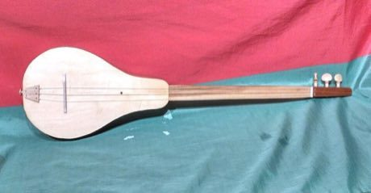

# Komuz

*комуз · Kyrgyz three-string lute*

**Encyclopedia ID 242** (permanent) · https://bpupadhyaya.github.io/world-heritage-games-site/games/242-komuz/

*Photo: Jo Dusepo, [CC BY-SA 4.0](https://creativecommons.org/licenses/by-sa/4.0/), [source on Wikimedia Commons](https://commons.wikimedia.org/wiki/File:Dusepo_komuz_front.jpg)*

Strum and pluck three open strings in time with scrolling notes, with the fast right-hand strumming patterns (kyiak) typical of the komuz.

## Heritage note

Part of the living heritage of Kyrgyzstan.

## Origins

Usually placed in the era of Crossroads and Golden Ages (about 500 to 1500), although its exact origins are uncertain, within the cultural world of Persia, Caucasus and Central Asia.

## Facts

- **Where:** Kyrgyzstan
- **Type:** Musical instruments
- **Family:** String instruments
- **Era:** [Crossroads and Golden Ages](../../eras/crossroads/index.md) (uncertain)
- **Cradle:** [Persia, Caucasus and Central Asia](../../cradles/persia-central-asia/index.md)
- **Region:** South and Central Asia

## Related entries

- [Dombra](../../games/48-dombra/index.md)
- [Tar and mugham modes](../../games/247-tar-and-mugham-modes/index.md)
- [Chonguri](../../games/255-chonguri/index.md)
- [Afghan Rubab Strings](../../games/1224-afghan-rubab-strings/index.md)
- [Charango](../../games/55-charango/index.md)
- [Erhu Two-String Fiddle](../../games/139-erhu-two-string-fiddle/index.md)

## Sources

- <https://commons.wikimedia.org/wiki/File:Dusepo_komuz_front.jpg>
