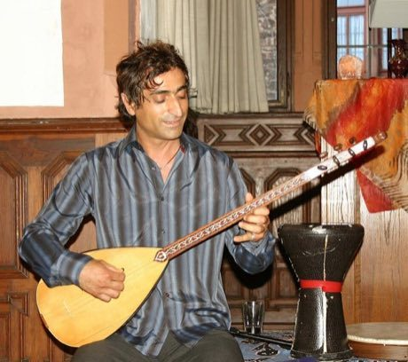

# Saz / Bağlama

*Bağlama · Turkish long-neck lute*

**Encyclopedia ID 243** (permanent) · https://bpupadhyaya.github.io/world-heritage-games-site/games/243-saz-baglama/

*Photo: Sven Teschke, CC BY-SA 2.0 de, [source on Wikimedia Commons](https://commons.wikimedia.org/wiki/File:SAZ_Instrument_5270.jpg)*

Press fret positions and pluck or strum the paired courses along folk melodies with the characteristic flat-pick tremolo.

## Heritage note

Part of the living heritage of Turkey.

## Origins

Usually placed in the era of Crossroads and Golden Ages (about 500 to 1500), although its exact origins are uncertain, within the cultural world of Mesopotamia, Levant and Arabia.

## Facts

- **Where:** Turkey
- **Type:** Musical instruments
- **Family:** String instruments
- **Era:** [Crossroads and Golden Ages](../../eras/crossroads/index.md) (uncertain)
- **Cradle:** [Mesopotamia, Levant and Arabia](../../cradles/mesopotamia-levant/index.md)
- **Region:** Middle East and North Africa

## Related entries

- [Buzuq Long-Neck Lute](../../games/218-buzuq-long-neck-lute/index.md)
- [Dombra](../../games/48-dombra/index.md)
- [Charango](../../games/55-charango/index.md)
- [Erhu Two-String Fiddle](../../games/139-erhu-two-string-fiddle/index.md)
- [Qanun](../../games/162-qanun/index.md)
- [Komuz](../../games/242-komuz/index.md)

## Sources

- <https://commons.wikimedia.org/wiki/File:SAZ_Instrument_5270.jpg>
