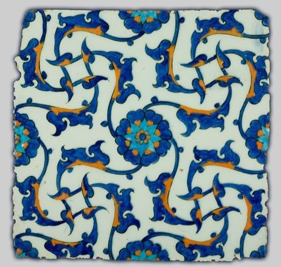

# Iznik tile painting

*İznik çinisi*

**Encyclopedia ID 244** (permanent) · https://equalinformation.com/world-heritage-games-site/games/244-iznik-tile-painting/

*Photo: Unknown, Turkey, 1560 (Turkey), [Public domain](https://creativecommons.org/publicdomain/mark/1.0/), [source on Wikimedia Commons](https://commons.wikimedia.org/wiki/File:Unknown,_Turkey,_1560_-_Iznik_Tile_-_Google_Art_Project.jpg)*

Fill an empty tile outline with cobalt, turquoise and tomato-red motifs (tulip, carnation, rosette) and mirror or repeat it so the panel tessellates.

## Heritage note

Part of the living heritage of Turkey.

## Origins

A living tradition passed from person to person; it is not tied to a single dated origin. It belongs to the cultural world of Mesopotamia, Levant and Arabia.

## Facts

- **Where:** Turkey
- **Type:** Crafts and making
- **Family:** Pottery, wood and metal crafts
- **Era:** [Living Traditions](../../eras/living/index.md)
- **Cradle:** [Mesopotamia, Levant and Arabia](../../cradles/mesopotamia-levant/index.md)
- **Region:** Middle East and North Africa

## Related entries

- [Damascus Mother-of-Pearl Inlay](../../games/223-damascus-mother-of-pearl-inlay/index.md)
- [Omani Khanjar Silver Filigree](../../games/1351-omani-khanjar-silver-filigree/index.md)
- [Zellij tile mosaic](../../games/21-zellij-tile-mosaic/index.md)
- [Swahili carved door](../../games/90-swahili-carved-door/index.md)
- [Thai fruit and vegetable carving](../../games/114-thai-fruit-and-vegetable-carving/index.md)
- [Glassblowing](../../games/121-glassblowing/index.md)

## Sources

- <https://commons.wikimedia.org/wiki/File:Unknown,_Turkey,_1560_-_Iznik_Tile_-_Google_Art_Project.jpg>
