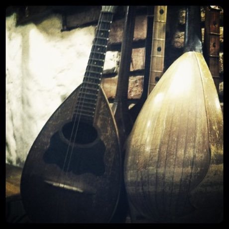

# Georgian three-voice polyphony

*Also known as: ქართული მრავალხმიანობა*

**Encyclopedia ID 245** (permanent) · https://bpupadhyaya.github.io/world-heritage-games-site/games/245-georgian-three-voice-polyphony/

*Photo: Anukitskvito, [CC BY-SA 4.0](https://creativecommons.org/licenses/by-sa/4.0/), [source on Wikimedia Commons](https://commons.wikimedia.org/wiki/File:Ensemble_Basiani.jpg)*

Georgian three-voice polyphony is a musical instrument tradition from Georgia.

## Heritage note

Part of the living heritage of Georgia.

## Origins

A living tradition passed from person to person; it is not tied to a single dated origin. It belongs to the cultural world of Persia, Caucasus and Central Asia.

## Facts

- **Where:** Georgia
- **Type:** Musical instruments
- **Era:** [Living Traditions](../../eras/living/index.md)
- **Cradle:** [Persia, Caucasus and Central Asia](../../cradles/persia-central-asia/index.md)
- **Region:** Europe

## Play it

[Web preview](https://bpupadhyaya.github.io/) · [Google Play](https://play.google.com/store/apps/details?id=com.equalinformation.arcforge.shell) · [App Store](https://apps.apple.com/us/app/arcforge-world-heritage-games/id6813746442)

## Related entries

- [Khinkali dumpling pleating](../../games/246-khinkali-dumpling-pleating/index.md)
- [Churchkhela](../../games/1255-churchkhela/index.md)
- [Ikat Pattern Dyeing](../../games/104-ikat-pattern-dyeing/index.md)
- [Santur Hammer Strings](../../games/138-santur-hammer-strings/index.md)
- [Persian Carpet Knotting](../../games/161-persian-carpet-knotting/index.md)
- [Lavash Baking](../../games/163-lavash-baking/index.md)

## Sources

- <https://commons.wikimedia.org/wiki/File:Ensemble_Basiani.jpg>
