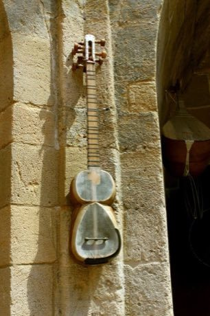

# Tar and mugham modes

*Also known as: Tar · Muğam · Azerbaijani long-neck lute*

**Encyclopedia ID 247** (permanent) · https://bpupadhyaya.github.io/world-heritage-games-site/games/247-tar-and-mugham-modes/

*Photo: Urek Meniashvili, [CC BY-SA 3.0](https://creativecommons.org/licenses/by-sa/3.0/), [source on Wikimedia Commons](https://commons.wikimedia.org/wiki/File:Azerbaijani_tar_(lute).JPG)*

Pick the doubled strings along a chosen mugham mode (dastgah-like scale) and improvise short phrases to match target contours.

## Heritage note

Part of the living heritage of Azerbaijan.

## Origins

Usually placed in the era of Crossroads and Golden Ages (about 500 to 1500), although its exact origins are uncertain, within the cultural world of Persia, Caucasus and Central Asia.

## Facts

- **Where:** Azerbaijan
- **Type:** Musical instruments
- **Family:** String instruments
- **Era:** [Crossroads and Golden Ages](../../eras/crossroads/index.md) (uncertain)
- **Cradle:** [Persia, Caucasus and Central Asia](../../cradles/persia-central-asia/index.md)
- **Region:** Europe

## Related entries

- [Dombra](../../games/48-dombra/index.md)
- [Komuz](../../games/242-komuz/index.md)
- [Chonguri](../../games/255-chonguri/index.md)
- [Afghan Rubab Strings](../../games/1224-afghan-rubab-strings/index.md)
- [Charango](../../games/55-charango/index.md)
- [Erhu Two-String Fiddle](../../games/139-erhu-two-string-fiddle/index.md)

## Sources

- <https://commons.wikimedia.org/wiki/File:Azerbaijani_tar_(lute).JPG>
