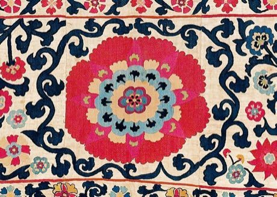

# Suzani embroidery

*Сузани*

**Encyclopedia ID 248** (permanent) · https://bpupadhyaya.github.io/world-heritage-games-site/games/248-suzani-embroidery/

*Photo: Unknown Shahrisyabz artisans. Photo by auctioneer, [Public domain](https://creativecommons.org/publicdomain/mark/1.0/), [source on Wikimedia Commons](https://commons.wikimedia.org/wiki/File:Shahrisyabz_suzani_(detail),_Uzbekistan.jpg)*

Stitch large sunburst medallions, vines and floral sprays in couched silk on a cotton panel, choosing colours so the pattern balances.

## Heritage note

Part of the living heritage of Uzbekistan, Tajikistan. Some forms of this practice carry deep meaning for the communities who keep it; here we describe the play and the craft only, with respect for its roots.

## Origins

A living tradition passed from person to person; it is not tied to a single dated origin. It belongs to the cultural world of Persia, Caucasus and Central Asia.

## Facts

- **Where:** Uzbekistan, Tajikistan
- **Type:** Crafts and making
- **Family:** Textile and weaving crafts
- **Era:** [Living Traditions](../../eras/living/index.md)
- **Cradle:** [Persia, Caucasus and Central Asia](../../cradles/persia-central-asia/index.md)
- **Region:** South and Central Asia

## Related entries

- [Ikat Pattern Dyeing](../../games/104-ikat-pattern-dyeing/index.md)
- [Persian Carpet Knotting](../../games/161-persian-carpet-knotting/index.md)
- [Turkmen gul carpet](../../games/249-turkmen-gul-carpet/index.md)
- [Kente strip weaving](../../games/22-kente-strip-weaving/index.md)
- [Celtic knot weave](../../games/25-celtic-knot-weave/index.md)
- [Sashiko Stitch Patterns](../../games/27-sashiko-stitch-patterns/index.md)

## Sources

- <https://commons.wikimedia.org/wiki/File:Shahrisyabz_suzani_(detail),_Uzbekistan.jpg>
