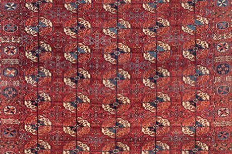

# Turkmen gul carpet

*Türkmen halysy · hali*

**Encyclopedia ID 249** (permanent) · https://bpupadhyaya.github.io/world-heritage-games-site/games/249-turkmen-gul-carpet/

*Photo: unknown Tekke artisan. Photos by auctioneer, [Public domain](https://creativecommons.org/publicdomain/mark/1.0/), [source on Wikimedia Commons](https://commons.wikimedia.org/wiki/File:Early_Tekke_Turkmen_hali_(main_carpet).jpg)*

Arrange knotted gul medallions and minor guls into rows with correct tribal symmetry, then colour them in madder red and indigo.

## Heritage note

Part of the living heritage of Turkmenistan.

## Origins

A living tradition passed from person to person; it is not tied to a single dated origin. It belongs to the cultural world of Persia, Caucasus and Central Asia.

## Facts

- **Where:** Turkmenistan
- **Type:** Crafts and making
- **Family:** Textile and weaving crafts
- **Era:** [Living Traditions](../../eras/living/index.md)
- **Cradle:** [Persia, Caucasus and Central Asia](../../cradles/persia-central-asia/index.md)
- **Region:** South and Central Asia

## Related entries

- [Ikat Pattern Dyeing](../../games/104-ikat-pattern-dyeing/index.md)
- [Persian Carpet Knotting](../../games/161-persian-carpet-knotting/index.md)
- [Suzani embroidery](../../games/248-suzani-embroidery/index.md)
- [Kente strip weaving](../../games/22-kente-strip-weaving/index.md)
- [Celtic knot weave](../../games/25-celtic-knot-weave/index.md)
- [Sashiko Stitch Patterns](../../games/27-sashiko-stitch-patterns/index.md)

## Sources

- <https://commons.wikimedia.org/wiki/File:Early_Tekke_Turkmen_hali_(main_carpet).jpg>
