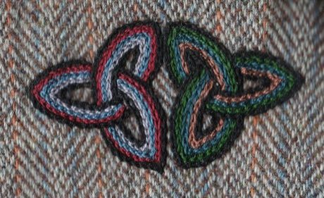

# Celtic knot weave

*Celtic knotwork*

**Encyclopedia ID 25** (permanent) · https://equalinformation.com/world-heritage-games-site/games/25-celtic-knot-weave/

*Photo: PKM, [CC BY 2.5](https://creativecommons.org/licenses/by/2.5/), [source on Wikimedia Commons](https://commons.wikimedia.org/wiki/File:Chain_stitch_embroidery_celtic_knot.jpg)*

Rotate tiles or crossings so one cord weaves over and under without breaks, completing each knot.

## Heritage note

Part of the living heritage of Ireland, United Kingdom. Some forms of this practice carry deep meaning for the communities who keep it; here we describe the play and the craft only, with respect for its roots.

## Origins

A living tradition passed from person to person; it is not tied to a single dated origin. It belongs to the cultural world of Celtic and Atlantic Europe.

## Facts

- **Where:** Ireland, United Kingdom
- **Type:** Crafts and making
- **Family:** Textile and weaving crafts
- **Era:** [Living Traditions](../../eras/living/index.md)
- **Cradle:** [Celtic and Atlantic Europe](../../cradles/celtic-atlantic/index.md)
- **Region:** Europe

## Related entries

- [Nordic Colourwork Knitting](../../games/413-nordic-colourwork-knitting/index.md)
- [Ribbon Pole Weave](../../games/419-ribbon-pole-weave/index.md)
- [Tartan Sett Weaving](../../games/505-tartan-sett-weaving/index.md)
- [Bobbin lace making](../../games/108-bobbin-lace-making/index.md)
- [Kente strip weaving](../../games/22-kente-strip-weaving/index.md)
- [Sashiko Stitch Patterns](../../games/27-sashiko-stitch-patterns/index.md)

## Sources

- <https://commons.wikimedia.org/wiki/File:Chain_stitch_embroidery_celtic_knot.jpg>
