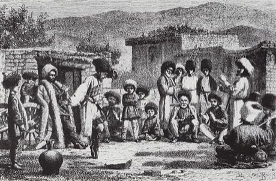

# Lezginka

*Also known as: Лезгинка · Caucasus dance*

**Encyclopedia ID 250** (permanent) · https://bpupadhyaya.github.io/world-heritage-games-site/games/250-lezginka/

*Photo: Vasily Vereshchagin, [Public domain](https://creativecommons.org/publicdomain/mark/1.0/), [source on Wikimedia Commons](https://commons.wikimedia.org/wiki/File:VereshchaginVasilyVasilyevich-Lezginka(1867).jpg)*

Lezginka is a dance tradition.

## Heritage note

A tradition shared by communities in many places. It is presented as sport and skill, never as real fighting.

## Origins

A living tradition passed from person to person; it is not tied to a single dated origin.

## Facts

- **Where:** Shared across many places
- **Type:** Dances
- **Family:** Folk and line dances
- **Era:** [Living Traditions](../../eras/living/index.md)
- **Cradle:** [Shared across the world](../../cradles/worldwide/index.md)
- **Region:** Middle East and North Africa

## Play it

[Try a 90-second preview in your browser](https://bpupadhyaya.github.io/games-site/games/lezginka/play/) · [Google Play](https://play.google.com/store/apps/details?id=com.equalinformation.arcforge.shell) · App Store (coming soon)

## Related entries

- [Dabke line dance](../../games/37-dabke-line-dance/index.md)
- [Gumboot dance rhythm](../../games/123-gumboot-dance-rhythm/index.md)
- [Balkan Kolo](../../games/134-balkan-kolo/index.md)
- [Tahtib](../../games/157-tahtib/index.md)
- [Eskista](../../games/188-eskista/index.md)
- [Jebena coffee brewing](../../games/189-jebena-coffee-brewing/index.md)

## Sources

- <https://commons.wikimedia.org/wiki/File:VereshchaginVasilyVasilyevich-Lezginka(1867).jpg>
