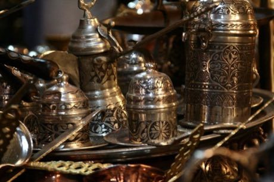

# Turkish coffee in the cezve

*Türk kahvesi*

**Encyclopedia ID 251** (permanent) · https://bpupadhyaya.github.io/world-heritage-games-site/games/251-turkish-coffee-in-the-cezve/

*Photo: Nico Crisafulli from USA, [CC BY 2.0](https://creativecommons.org/licenses/by/2.0/), [source on Wikimedia Commons](https://commons.wikimedia.org/wiki/File:To_make_the_Turkish_Coffee_(3180372276).jpg)*

Add water, sugar and finely ground coffee to a copper cezve and lift it from the sand or flame just as the foam rises, twice, without boiling over.

## Heritage note

Part of the living heritage of Turkey. Some forms of this practice carry deep meaning for the communities who keep it; here we describe the play and the craft only, with respect for its roots.

## Origins

A living tradition passed from person to person; it is not tied to a single dated origin. It belongs to the cultural world of Mesopotamia, Levant and Arabia.

## Facts

- **Where:** Turkey
- **Type:** Crafts and making
- **Era:** [Living Traditions](../../eras/living/index.md)
- **Cradle:** [Mesopotamia, Levant and Arabia](../../cradles/mesopotamia-levant/index.md)
- **Region:** Middle East and North Africa

## Related entries

- [Ebru paper marbling](../../games/20-ebru-paper-marbling/index.md)
- [Iznik tile painting](../../games/244-iznik-tile-painting/index.md)
- [Dabke line dance](../../games/37-dabke-line-dance/index.md)
- [Tatreez Palestinian Cross-Stitch](../../games/212-tatreez-palestinian-cross-stitch/index.md)
- [Jordanian Sand Bottle Art](../../games/219-jordanian-sand-bottle-art/index.md)
- [Mijwiz Double Clarinet](../../games/221-mijwiz-double-clarinet/index.md)

## Sources

- <https://commons.wikimedia.org/wiki/File:To_make_the_Turkish_Coffee_(3180372276).jpg>
