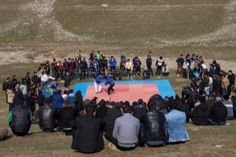

# Kurash

*Also known as: Кураш · Uzbek belt wrestling*

**Encyclopedia ID 253** (permanent) · https://bpupadhyaya.github.io/world-heritage-games-site/games/253-kurash/

*Photo: Sinchalak Musulmon, [CC BY-SA 4.0](https://creativecommons.org/licenses/by-sa/4.0/), [source on Wikimedia Commons](https://commons.wikimedia.org/wiki/File:Kurash._Uzbek_national_sport.jpg)*

Time throws and counter-throws on a belt-grip duel; a clean throw scores halal, yonbosh or chala points and a perfect throw wins outright.

## Heritage note

Part of the living heritage of Uzbekistan.

## Origins

Usually placed in the era of River Valleys and First Cities (about 3000 to 1000 BCE), although its exact origins are uncertain, within the cultural world of Persia, Caucasus and Central Asia.

## Facts

- **Where:** Uzbekistan
- **Type:** Wrestling and martial sports
- **Family:** Wrestling
- **Era:** [River Valleys and First Cities](../../eras/river-valleys/index.md) (uncertain)
- **Cradle:** [Persia, Caucasus and Central Asia](../../cradles/persia-central-asia/index.md)
- **Region:** South and Central Asia

## Play it

[Web preview](https://bpupadhyaya.github.io/) · [Google Play](https://play.google.com/store/apps/details?id=com.equalinformation.arcforge.shell) · [App Store](https://apps.apple.com/us/app/arcforge-world-heritage-games/id6813746442)

## Related entries

- [Chidaoba](../../games/734-chidaoba/index.md)
- [Gushtingiri wrestling](../../games/1133-gushtingiri-wrestling/index.md)
- [Kokh](../../games/1317-kokh/index.md)
- [Laamb Wrestling Bout](../../games/166-laamb-wrestling-bout/index.md)
- [Kushti / Pehlwani mud wrestling](../../games/256-kushti-pehlwani-mud-wrestling/index.md)
- [Sumo bout](../../games/359-sumo-bout/index.md)

## Sources

- <https://commons.wikimedia.org/wiki/File:Kurash._Uzbek_national_sport.jpg>
