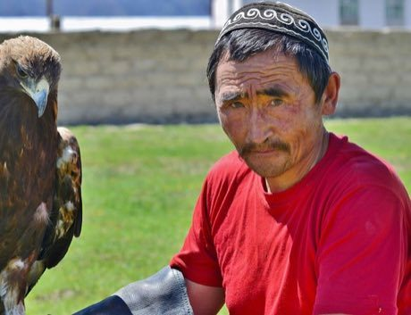

# Steppe eagle hunting

*Бүркітші · berkutchi*

**Encyclopedia ID 254** (permanent) · https://bpupadhyaya.github.io/world-heritage-games-site/games/254-steppe-eagle-hunting/

*Photo: Altaihunters, [CC BY-SA 3.0](https://creativecommons.org/licenses/by-sa/3.0/), [source on Wikimedia Commons](https://commons.wikimedia.org/wiki/File:Kazakh-Mongolian_Eagle_Hunter.JPG)*

Track a fox on the winter steppe, release the eagle at the right moment and wind and call it back to the glove for a clean return.

## Heritage note

Part of the living heritage of Kazakhstan. Animals are partners in this tradition; good care and local rules always come first.

## Origins

Usually placed in the era of Modern Heritage (1800 to today), although its exact origins are uncertain, within the cultural world of Steppe and Arctic.

## Facts

- **Where:** Kazakhstan
- **Type:** Dexterity and skill games
- **Family:** Hunt and blockade games
- **Era:** [Modern Heritage](../../eras/modern/index.md) (uncertain)
- **Cradle:** [Steppe and Arctic](../../cradles/steppe-arctic/index.md)
- **Region:** South and Central Asia

## Related entries

- [Mheibes](../../games/158-mheibes/index.md)
- [Ger raising](../../games/101-ger-raising/index.md)
- [Kok-boru](../../games/241-kok-boru/index.md)
- [Pilolo](../../games/750-pilolo/index.md)
- [Lambs and Tigers](../../games/791-lambs-and-tigers/index.md)
- [Kokpar](../../games/857-kokpar/index.md)

## Sources

- <https://commons.wikimedia.org/wiki/File:Kazakh-Mongolian_Eagle_Hunter.JPG>
