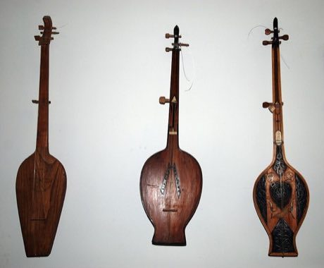

# Chonguri

*ჭონგური · Georgian four-string lute*

**Encyclopedia ID 255** (permanent) · https://bpupadhyaya.github.io/world-heritage-games-site/games/255-chonguri/

*Photo: Bertramz, [CC BY-SA 3.0](https://creativecommons.org/licenses/by-sa/3.0/), [source on Wikimedia Commons](https://commons.wikimedia.org/wiki/File:Chonguri,Tbilisi2.jpg)*

Strum and fret the short-necked lute in time with songs.

## Heritage note

Part of the living heritage of Georgia.

## Origins

Usually placed in the era of Crossroads and Golden Ages (about 500 to 1500), although its exact origins are uncertain, within the cultural world of Persia, Caucasus and Central Asia.

## Facts

- **Where:** Georgia
- **Type:** Musical instruments
- **Family:** String instruments
- **Era:** [Crossroads and Golden Ages](../../eras/crossroads/index.md) (uncertain)
- **Cradle:** [Persia, Caucasus and Central Asia](../../cradles/persia-central-asia/index.md)
- **Region:** Europe

## Related entries

- [Dombra](../../games/48-dombra/index.md)
- [Komuz](../../games/242-komuz/index.md)
- [Tar and mugham modes](../../games/247-tar-and-mugham-modes/index.md)
- [Afghan Rubab Strings](../../games/1224-afghan-rubab-strings/index.md)
- [Charango](../../games/55-charango/index.md)
- [Erhu Two-String Fiddle](../../games/139-erhu-two-string-fiddle/index.md)

## Sources

- <https://commons.wikimedia.org/wiki/File:Chonguri,Tbilisi2.jpg>
