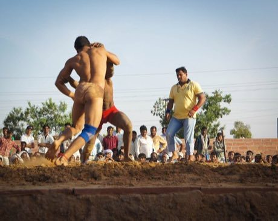

# Kushti / Pehlwani mud wrestling

*kushti, pehlwani*

**Encyclopedia ID 256** (permanent) · https://bpupadhyaya.github.io/world-heritage-games-site/games/256-kushti-pehlwani-mud-wrestling/

*Photo: Lebd, [CC BY-SA 3.0](https://creativecommons.org/licenses/by-sa/3.0/), [source on Wikimedia Commons](https://commons.wikimedia.org/wiki/File:Kushti_%28in_Bharatpur_March_2013%29.jpg)*

Two pehlwans grapple on a soft clay pit and win by pinning the opponent's shoulders to the ground or by winning on points.

## Heritage note

Part of the living heritage of India, Pakistan.

## Origins

Usually placed in the era of River Valleys and First Cities (about 3000 to 1000 BCE), although its exact origins are uncertain, within the cultural world of South Asia.

## Facts

- **Where:** India, Pakistan
- **Type:** Wrestling and martial sports
- **Family:** Wrestling
- **Era:** [River Valleys and First Cities](../../eras/river-valleys/index.md) (uncertain)
- **Cradle:** [South Asia](../../cradles/south-asia/index.md)
- **Region:** South and Central Asia

## Related entries

- [Boli Khela](../../games/572-boli-khela/index.md)
- [Laamb Wrestling Bout](../../games/166-laamb-wrestling-bout/index.md)
- [Kurash](../../games/253-kurash/index.md)
- [Sumo bout](../../games/359-sumo-bout/index.md)
- [Ssireum](../../games/366-ssireum/index.md)
- [Bökh](../../games/374-bokh/index.md)

## Sources

- <https://commons.wikimedia.org/wiki/File:Kushti_%28in_Bharatpur_March_2013%29.jpg>
