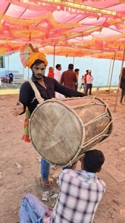

# Dhol drum rhythm

*Also known as: dhol*

**Encyclopedia ID 263** (permanent) · https://bpupadhyaya.github.io/world-heritage-games-site/games/263-dhol-drum-rhythm/

*Photo: Suyash Dwivedi, [CC BY-SA 4.0](https://creativecommons.org/licenses/by-sa/4.0/), [source on Wikimedia Commons](https://commons.wikimedia.org/wiki/File:Dhol_players_at_Bhagoria_Festival_2026%2C_Ranapur_02.jpg)*

Hit the two heads of a barrel dhol with a stick and a thin switch to the tempo as bhangra-style beats scroll.

## Heritage note

Part of the living heritage of India.

## Origins

A living tradition passed from person to person; it is not tied to a single dated origin. It belongs to the cultural world of South Asia.

## Facts

- **Where:** India
- **Type:** Musical instruments
- **Family:** Drums and percussion
- **Era:** [Living Traditions](../../eras/living/index.md)
- **Cradle:** [South Asia](../../cradles/south-asia/index.md)
- **Region:** South and Central Asia

## Related entries

- [Talking drum](../../games/33-talking-drum/index.md)
- [Marimba](../../games/52-marimba/index.md)
- [Calabash Water Drum](../../games/180-calabash-water-drum/index.md)
- [Amadinda and embaire](../../games/185-amadinda-and-embaire/index.md)
- [Tombak goblet drum rhythms](../../games/233-tombak-goblet-drum-rhythms/index.md)
- [Ranat ek](../../games/305-ranat-ek/index.md)

## Sources

- <https://commons.wikimedia.org/wiki/File:Dhol_players_at_Bhagoria_Festival_2026%2C_Ranapur_02.jpg>
