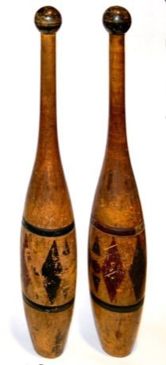

# Indian club swinging

*mugdar, jori, meels · mugdar / jori*

**Encyclopedia ID 264** (permanent) · https://equalinformation.com/world-heritage-games-site/games/264-indian-club-swinging/

*Photo: Sobebunny, [CC BY-SA 3.0](https://creativecommons.org/licenses/by-sa/3.0/), [source on Wikimedia Commons](https://commons.wikimedia.org/wiki/File:Indian_clubs.jpg)*

Swing paired heavy clubs in circles and arcs, matching the moves and tempo shown to build a flowing routine.

## Heritage note

Part of the living heritage of India, Pakistan.

## Origins

Usually placed in the era of Modern Heritage (1800 to today), although its exact origins are uncertain, within the cultural world of South Asia.

## Facts

- **Where:** India, Pakistan
- **Type:** Dexterity and skill games
- **Family:** Winter sports
- **Era:** [Modern Heritage](../../eras/modern/index.md) (uncertain)
- **Cradle:** [South Asia](../../cradles/south-asia/index.md)
- **Region:** South and Central Asia

## Related entries

- [Bhavai pot-balance dance](../../games/268-bhavai-pot-balance-dance/index.md)
- [Chinlone](../../games/16-chinlone/index.md)
- [Pinata swing](../../games/61-pinata-swing/index.md)
- [Ring Tilting](../../games/65-ring-tilting/index.md)
- [Yukigassen Snow Fort](../../games/71-yukigassen-snow-fort/index.md)
- [Bagatelle](../../games/72-bagatelle/index.md)

## Sources

- <https://commons.wikimedia.org/wiki/File:Indian_clubs.jpg>
